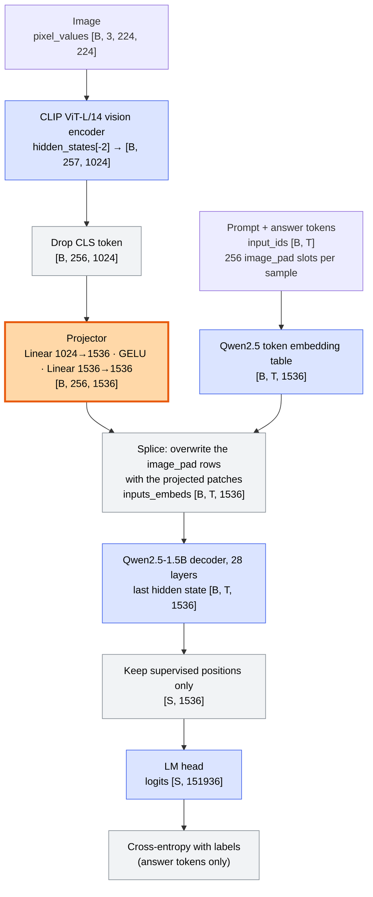

# research_stage_01
Multimodal reasoning models Stage-1

## E1.1 Minimal VLM

A hand-written VLM: frozen vision encoder → trainable projector → frozen LLM. Only the projector is trained, on a 50k subset of LLaVA-Instruct (detail descriptions + conversations) with COCO images.

| Part | Default |
|---|---|
| Vision encoder | `openai/clip-vit-large-patch14`, 224 px, penultimate layer, CLS dropped → 256 tokens × 1024 |
| Projector | `Linear(1024→1536) → GELU → Linear(1536→1536)` |
| LLM | `Qwen/Qwen2.5-1.5B-Instruct` |

### Architecture and tensor shapes

Shapes are for the default configuration with a batch of `B` samples, sequence length `T`, and `S` supervised positions in the batch.



Blue blocks are frozen, the orange block is the only one trained (3.94M parameters), grey blocks are operations without weights. The loss gradient flows back through the frozen LLM to reach the projector, which is why the LLM's activations dominate GPU memory even though its weights never change.

Measured with `scripts/04_trace_shapes.py` on one real batch (`B = 4`, `T = 482`, `S = 433`):

| Tensor | Shape | Notes |
|---|---|---|
| `pixel_values` | `[4, 3, 224, 224]` | CLIP preprocessing: resize and centre-crop to 224 px |
| encoder `hidden_states[-2]` | `[4, 257, 1024]` | 1 CLS + 16×16 patches of 14 px, penultimate layer |
| patch features | `[4, 256, 1024]` | CLS dropped |
| projector output | `[4, 256, 1536]` | now in the LLM's embedding space |
| `input_ids` | `[4, 482]` | longest sequence in the batch; shorter ones are padded |
| text embeds | `[4, 482, 1536]` | embedding lookup, including the placeholder slots |
| `inputs_embeds` after splice | `[4, 482, 1536]` | 256 placeholder rows per sample replaced by patches |
| LLM last hidden state | `[4, 482, 1536]` | |
| `labels` | `[4, 482]` | `-100` everywhere except answer tokens |
| logits | `[433, 151936]` | supervised positions only, not `[4, 482, 151936]` |

One training sequence, with the 256 image slots collapsed. Only the assistant's answer and its closing `<|im_end|>` are supervised:

```text
<|im_start|>system
You are a helpful assistant.<|im_end|>
<|im_start|>user
<|vision_start|><|image_pad|>x256<|vision_end|>
What is this photo about?<|im_end|>
<|im_start|>assistant
The image features a group of people gathered together in a cozy living room ...<|im_end|>
```

### Run from a terminal (Colab L4)

```bash
git clone https://github.com/avbarbaros/research_stage_01.git && cd research_stage_01
python scripts/01_setup.py           # GPU check, pip install, show data/runs paths
python scripts/02_run_tests.py       # CPU unit tests
python scripts/03_smoke_test.py      # 500 samples, 0.5B LLM, 30 steps
python scripts/04_trace_shapes.py    # tensor shapes at the vision-language interface
python scripts/05_prepare_data.py    # 50k subset + COCO images
python scripts/06_train.py           # main run; re-run to resume
python scripts/07_plot_loss.py       # -> <run>/loss.png
python scripts/08_eval_grounding.py  # correct vs shuffled vs blank image
python scripts/09_eval_captions.py   # 200 COCO val captions + CIDEr
python scripts/10_show_results.py    # results + <run>/captions_grid.png
python scripts/11_eval_reference_likelihood.py  # loss of the COCO reference captions, correct vs other image
python scripts/12_compare_runs.py RUN_A RUN_B ...  # paired comparison of runs, e.g. encoders (E1.2)
python scripts/13_eval_options.py    # MMVP + A-OKVQA by option likelihood; re-run 12 afterwards
python scripts/14_projector_ablation.py  # projector sizes on 10k samples: train, evaluate, compare
```

### Settings

All paths and hyper-parameters are in [config.yaml](config.yaml). Precedence is command-line flag > environment variable (paths only) > `config.yaml`.

- One-off override: scripts 03, 05, 06, 08 and 09 pass extra arguments to the underlying module, e.g. `python scripts/06_train.py --batch_size 4 --accum 8`.
- Another settings file: add `--config other.yaml` to any script or module.
- Each run saves the model and optimisation settings it used to `<run>/config.json`; evaluation reads the model from there, not from `config.yaml`.

#### `paths`

| Key | Default | Meaning |
|---|---|---|
| `data_dir` | `/content/data` | Datasets and images, on local disk. Env: `DATA_DIR`. |
| `runs_dir` | `/content/drive/MyDrive/MMRM/stage_01/e1_1_minivlm` | Checkpoints, logs, results. Env: `RUNS_DIR`. |
| `runs_dir_fallback` | `runs` | Used when `runs_dir` is on Google Drive and Drive is not mounted. |
| `run_name` | `main_clip_qwen1.5b` | Main run directory inside `runs_dir`. Env: `RUN_NAME`. |

Relative paths are resolved against the repository root. Drive can only be mounted from a notebook cell (`from google.colab import drive; drive.mount('/content/drive')`), not from the terminal. The defaults are Colab paths; elsewhere, set `DATA_DIR` or edit the file.

#### `model`

| Key | Default | Meaning |
|---|---|---|
| `encoder` | `clip` | `clip`, `siglip`, `dinov2`, or `clip-b32` (small, for CPU debugging). Model ids are in [minivlm/config.py](minivlm/config.py). |
| `llm` | `Qwen/Qwen2.5-1.5B-Instruct` | Frozen language model. |
| `feature_layer` | `-2` | Vision encoder hidden state fed to the projector (penultimate). |
| `projector` | `mlp2` | `mlp2` (two-layer MLP) or `linear`. |
| `projector_hidden` | `0` | Hidden width of the MLP; `0` means the LLM hidden size, a small value makes a bottleneck. |
| `grad_checkpointing` | `false` | Slower, less GPU memory. |

#### `data`

| Key | Default | Meaning |
|---|---|---|
| `subset` | `main` | Name of the prepared subset inside `data_dir`. |
| `n_total` | `50000` | Training samples. |
| `n_holdout` | `500` | Held-out detail descriptions, split by image. |
| `detail_fraction` | `0.46` | Share of detail descriptions; the rest are conversations. |
| `max_text_tokens` | `256` | Token budget per sample, image tokens not counted. |
| `seed` | `0` | Seed for sampling the subset. |
| `download_workers` | `32` | Parallel COCO image downloads. |

#### `train`

| Key | Default | Meaning |
|---|---|---|
| `lr` | `1.0e-3` | Peak learning rate (AdamW, cosine decay). |
| `weight_decay` | `0.0` | |
| `warmup_ratio` | `0.03` | Fraction of optimiser steps used for linear warmup. |
| `batch_size` | `8` | Samples per forward pass. 16 does not fit a 22 GB L4 with the 1.5B LLM. |
| `accum` | `4` | Gradient accumulation; effective batch is `batch_size * accum`. |
| `epochs` | `1` | |
| `max_grad_norm` | `1.0` | Gradient clipping. |
| `seed` | `0` | Seed for initialisation and data order. |
| `save_every` | `500` | Checkpoint interval, in optimiser steps. |
| `log_every` | `10` | Logging interval, in optimiser steps. |
| `num_workers` | `4` | DataLoader workers. |

#### `smoke`

Used only by `scripts/03_smoke_test.py`; anything not listed here comes from `model` and `train`.

| Key | Default | Meaning |
|---|---|---|
| `subset` | `smoke` | Subset name for the smoke data. |
| `run_name` | `smoke` | Run directory inside `runs_dir`. |
| `llm` | `Qwen/Qwen2.5-0.5B-Instruct` | Smaller LLM for a quick check. |
| `n_total` / `n_holdout` | `500` / `50` | Subset size. |
| `batch_size` / `accum` | `8` / `2` | |
| `max_steps` | `30` | Optimiser steps before stopping. |
| `log_every` | `5` | |

#### `eval`

| Key | Default | Meaning |
|---|---|---|
| `batch_size` | `16` | |
| `num_workers` | `4` | DataLoader workers for the grounding control. |
| `caption_n` | `200` | COCO val2017 images to caption. |
| `short_max_new_tokens` | `96` | Token limit for the "one short sentence" prompt. At 40, a third of the captions were cut mid-sentence. |
| `max_new_tokens` | `128` | Token limit for the detailed-description prompt. |
| `cider` | `true` | Score the short captions with CIDEr (see below). |
| `bootstrap_samples` | `5000` | Resamples for the 95% intervals on CIDEr. |
| `seed` | `0` | Seed for picking the val images and for the bootstrap. |

CIDEr is reported three ways, each with a 95% bootstrap interval over images: on the whole short caption, on its first sentence only, and on captions that finished before the token limit. The model writes LLaVA-style paragraphs where COCO references are one sentence, so the whole-caption score mostly measures length; the first-sentence score is the fairer comparison between runs. All three use a simple tokeniser and IDF from the scored images, so they are for comparisons within this project, not with published numbers. `python -m minivlm.eval rescore --out_dir <run>` recomputes them for an existing `captions.json` without a GPU.

`11_eval_reference_likelihood.py` scores the same images without generating anything: the loss per token of their five COCO reference captions under the short-caption prompt, once with the correct image and once with the next image in the list. If an encoder gives the references a low loss but its generated captions score poorly, its features carry the information and the problem is in decoding; if the references also get a high loss, the features suit short captions less. `12_compare_runs.py` compares both results across runs, pairing scores image by image, and saves `<runs_dir>/comparison.json`.

`13_eval_options.py` scores two multiple-choice benchmarks without generating anything: each option is written as the answer to "<question> Answer the question using a single word or phrase.", and the option with the lowest loss is the prediction. Every option has the same format, so the output-format prior that distorts the caption metrics largely cancels. Accuracy is reported with two scores (summed loss, which favours short options, and loss per token) and with a blank image, which shows what the language prior alone achieves.

- **MMVP**: 150 pairs of images that CLIP embeds almost identically but that differ visibly; both questions of a pair are the same, with opposite answers. Pair accuracy (both right) is the standard metric; chance is 25%, and a model that ignores the image scores 0.
- **A-OKVQA** validation: 1,145 questions on COCO val2017 images, four options each (chance 25%).

Both are downloaded from the Hugging Face Hub on first use. `12_compare_runs.py` includes them once every run has `options_mmvp.json` / `options_aokvqa.json`. It also compares the held-out grounding losses sample by sample, for `grounding.json` files that include per-sample losses (written by `08_eval_grounding.py` from this version on).

`14_projector_ablation.py` answers "what breaks when the projector is too small": it trains the default two-layer MLP, the same MLP with a 64- and a 16-wide hidden layer, and a single linear layer, all on the first 10k samples of the main subset, runs the grounding, reference and multiple-choice evaluations for each, and prints the paired comparison, a one-line summary per size and a combined loss plot (`<runs_dir>/projector_ablation_<encoder>_loss.png`). Re-running it resumes training and skips finished evaluations; `--variants` and `--max_samples` change the sweep.

### Underlying modules

```bash
python -m minivlm.data                                  # subset + images
python -m minivlm.train --out_dir runs/main --resume    # train projector
python -m minivlm.eval grounding --out_dir runs/main    # correct vs shuffled vs blank image
python -m minivlm.eval caption   --out_dir runs/main
python -m minivlm.eval rescore   --out_dir runs/main    # recompute caption metrics, no GPU
python -m minivlm.eval reference --out_dir runs/main    # reference-caption likelihood
python -m minivlm.eval options   --out_dir runs/main    # MMVP + A-OKVQA option likelihood
python -m minivlm.compare runs/a runs/b --names a b     # paired comparison of runs
pytest tests                                            # CPU, tiny random models
```

Defaults come from `config.yaml`; every setting also has a flag (`--help`). Useful training flags: `--encoder {clip,siglip,dinov2}` (E1.2), `--projector linear`, `--projector_hidden 64` (bottleneck), `--batch_size 4 --accum 8` or `--grad_checkpointing` if memory is short. `--encoder clip-b32` is a small encoder for debugging on CPU.

### Layout

- [docs/MiniVLM_E1.1_E1.2.md](docs/MiniVLM_E1.1_E1.2.md) — full write-up of E1.1 and E1.2: architecture, training, every evaluation and the results.
- [docs/E1.3_resolution_study.md](docs/E1.3_resolution_study.md) — E1.3: Qwen2.5-VL-7B accuracy against visual tokens, results and interpretation.

- [minivlm/model.py](minivlm/model.py) — `MiniVLM`; the tensor shapes at the vision–language interface are listed at the top of the file.
- [minivlm/data.py](minivlm/data.py) — subset builder, COCO download, chat-format tokenisation and label masking.
- [e1_3/](e1_3/) — E1.3 resolution sweep: token arithmetic, dataset subsets, VLMEvalKit driver, analysis.
- [e1_4/](e1_4/) — E1.4 bottleneck probe: COCO task construction across encoder views, linear probes, driver, analysis.
- [minivlm/benchmarks.py](minivlm/benchmarks.py) — MMVP and A-OKVQA loaders.
- [minivlm/metrics.py](minivlm/metrics.py) — CIDEr variants, likelihood and multiple-choice measures, bootstrap intervals; [minivlm/compare.py](minivlm/compare.py) — paired comparison of runs.
- [minivlm/train.py](minivlm/train.py), [minivlm/eval.py](minivlm/eval.py), [minivlm/config.py](minivlm/config.py)

## E1.3 Resolution study (Qwen2.5-VL-7B, VLMEvalKit)

Accuracy of Qwen2.5-VL-7B-Instruct against the number of visual tokens per image, per task category. One visual token covers 28×28 pixels; setting VLMEvalKit's `min_pixels` and `max_pixels` to the same value fixes the token count for every image (`e1_3/tokens.py`). Each budget runs on seeded subsets of three VLMEvalKit datasets, scored by their official evaluators:

- **MMBench_DEV_EN**: multiple choice with circular evaluation, six ability groups (coarse perception, fine-grained perception, reasoning types). Subsets keep each question's rotated copies together.
- **TextVQA_VAL**: reading text in natural images (VQA score).
- **ChartQA_TEST**: reading charts (relaxed accuracy).

```bash
python scripts/15_setup_vlmevalkit.py        # once per runtime: clone, pin, install, import check
python scripts/16_resolution_quick_check.py  # 2 budgets x 20 questions + estimated time for the full sweep
python scripts/17_resolution_sweep.py        # full sweep, resumable
```

`15_setup_vlmevalkit.py` clones VLMEvalKit to `resolution.vlmevalkit_dir`, checks out the tested commit (`resolution.vlmevalkit_commit`), installs it without dependencies, installs its requirements without touching the runtime's torch (one by one if the bulk install fails), adds `rouge-score` (imported by VLMEvalKit but missing from its requirements) and `qwen-vl-utils`, and finishes with an import check that installs any module still missing. `--flash_attn` also tries to install FlashAttention-2; without it the sweep uses PyTorch's SDPA attention (same results, slower).

`16_resolution_quick_check.py` runs the same code on a small sweep (`resolution.quick_check_budgets` and `quick_check_n`, results in `<runs_dir>/<run_name>_check`), prints its analysis, and extrapolates from the measured seconds per answer how many hours the full sweep will take on this GPU.

The full sweep is 6 budgets × (300 MMBench question groups ≈ 1,150 rows + 300 + 300 questions), about 10,500 generations. It ends with `e1_3.analysis`, which prints accuracy with 95% bootstrap intervals per category and budget, marks the point of diminishing returns (the smallest budget not clearly below the best, paired over the same questions), and saves `summary.json` and `resolution_sweep.png` in `<runs_dir>/e1_3_qwen2.5vl7b/`. Budgets, datasets and subset size are in the `resolution` section of `config.yaml`.

## E1.4 Bottleneck probe (MiniVLM, COCO)

Does MiniVLM report what its frozen vision encoder encodes? For each of the three trained runs (CLIP, SigLIP, DINOv2), a linear probe is trained on the exact patch features the projector receives, and MiniVLM is asked the same questions about the same images by option likelihood. The difference between the two accuracies is the information lost between the encoder and the answer.

Three questions about people, labelled from the COCO val2017 box annotations:

| Task | Question | Options |
|---|---|---|
| presence | Is there a person in the image? | Yes / No |
| count | How many people are in the image? | 0, 1, 2, 3, 4, 5 or more |
| position | Is the person on the left or the right side of the image? (images with one person) | Left / Right |

Each encoder sees a different part of the image (CLIP and DINOv2 crop the centre, SigLIP squashes the whole image), so labels are computed inside each encoder's view and an image is kept only if its label is unambiguous and identical in all three views. Persons smaller than 1% of the view are not counted, and images with half-visible or borderline-size persons are dropped. Test sets are class-balanced and identical for every encoder; the remaining images train the probes.

- **Probes:** multinomial logistic regression on standardised features, pooled as the mean over all patches and as a 4×4 grid of patch blocks (the grid keeps coarse layout and is the primary probe); the L2 penalty is chosen on a held-out 20% of the training images. A learning curve (16, 64, all training images per class) shows how easily the information can be read out.
- **MiniVLM:** each option scored as the answer to the question with LLaVA's short-answer prompt, with the real image and with a blank image (the language prior alone).
- **Output:** per task and encoder, probe and MiniVLM accuracy with 95% bootstrap intervals, the paired gap (probe minus MiniVLM's better score), MiniVLM's answer distribution, and paired comparisons between encoders; `summary.json` and `bottleneck_probe.png` in `<runs_dir>/e1_4_probe/`.

```bash
python scripts/18_bottleneck_probe.py
```

It downloads COCO's annotation file and the val2017 images the tasks use, and needs the three trained main runs (`probe.runs` in `config.yaml`). Re-running reuses finished runs and extracted features.
