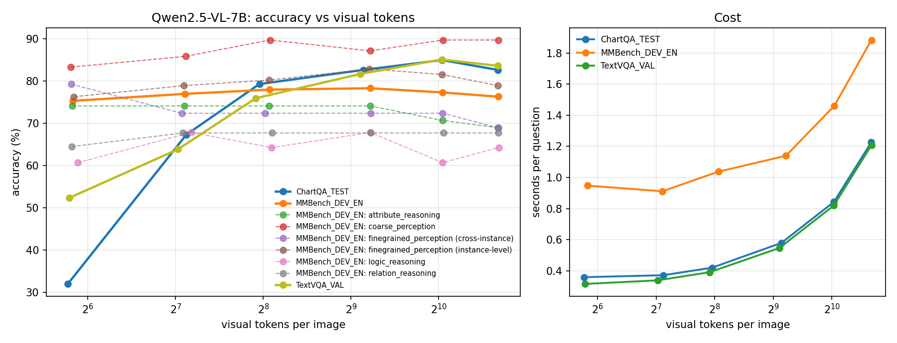

# E1.3: how many visual tokens does a VLM need?

**Stage 1 · Experiment E1.3 · research_stage_01**

Qwen2.5-VL-7B-Instruct evaluated on three benchmarks at six fixed visual-token budgets, from 64 to 1,600 tokens per image, using VLMEvalKit. The question: how much image resolution does a strong, fully trained vision-language model need, and does the answer depend on the kind of question?

---

## Summary

**Roadmap task (E1.3):** evaluate Qwen2.5-VL-7B on the same benchmark at several input resolutions. **Success criterion:** a plot of accuracy against visual token count, and the point of diminishing returns for each task category. **Status: met** (Figure 1, §4–5).

**Findings:**

1. **Resolution matters for reading, not for general perception.** Going from 64 to 1,024 tokens per image lifts ChartQA from **32% to 85%** and TextVQA from **52% to 85%**, but MMBench only from **75% to 77–78%**, which is not a clear difference.
2. **Accuracy stops improving at about each image's own resolution.** ChartQA images are ≈595 tokens natively and level off at 576; TextVQA images are ≈963 tokens and level off at 1,024; MMBench images are ≈197 tokens and are already near their best at 64–144.
3. **Enlarging an image beyond its own resolution never helps.** ChartQA at 1,600 tokens is clearly *worse* than at 1,024; on the other benchmarks the extra tokens change nothing. They only cost time.
4. **Cost grows faster than accuracy.** From 576 to 1,024 tokens, each answer takes 45–50% longer, for 2–3 points on the reading benchmarks.
5. **For MiniVLM (E1.1–E1.2):** its 224×224 input equals the 64-token budget. At that resolution even Qwen2.5-VL-7B loses 53 points on ChartQA and 33 on TextVQA, so reading tasks would be limited by the input size before anything else.

**Practical rule for this model:** give each image about as many tokens as it has at its own resolution, and no more.

---

## 1 · Background: what a "visual token" is

A vision-language model (VLM) turns an image into a sequence of vectors, **visual tokens**, that the language model reads alongside the words of the question. More tokens mean more image detail, but also a longer input and slower answers.

**How Qwen2.5-VL makes its tokens.** The vision encoder cuts the image into 14×14-pixel patches, then merges each 2×2 block of patches into one token. So **one visual token covers 28×28 pixels**:

| Image size (pixels) | Visual tokens |
|---|---|
| 224 × 224 | 8 × 8 = **64** |
| 336 × 336 | 12 × 12 = **144** |
| 448 × 448 | 16 × 16 = **256** |
| 672 × 672 | 24 × 24 = **576** |
| 896 × 896 | 32 × 32 = **1,024** |
| 1,120 × 1,120 | 40 × 40 = **1,600** |

**Native resolution.** Unlike older VLMs that squash every image to a fixed size (MiniVLM uses 224×224), Qwen2.5-VL normally keeps roughly each image's own size: it only rounds the sides to multiples of 28 and keeps the area between two limits, `min_pixels` and `max_pixels`. The number of tokens an image gets this way is called its **native resolution** in this document.

**Fixing the budget.** Setting `min_pixels` and `max_pixels` to the same value, *budget* × 28 × 28, forces every image to about *budget* tokens, whatever its original size. Large images are shrunk; small ones are enlarged. The aspect ratio is kept, so the exact count varies slightly around the budget (the tables report the mean).

---

## 2 · Setup

### 2.1 Benchmarks

All three come from VLMEvalKit, the evaluation harness used in Stage 0, and are scored by its official evaluators.

| Benchmark (VLMEvalKit name) | What it tests | Kind of question (illustrative) | Scoring | Native resolution |
|---|---|---|---|---|
| **ChartQA_TEST** | reading values and labels in charts | "What is the value of the blue bar in 2019?" | relaxed accuracy: numbers may differ by up to 5% | ≈595 tokens |
| **TextVQA_VAL** | reading text in everyday photos | "What brand is the drink?" | VQA score: agreement with 10 human answers | ≈963 tokens |
| **MMBench_DEV_EN** | general perception and reasoning, 6 ability groups | multiple-choice questions about scenes, objects, attributes and relations | circular evaluation (below), exact matching | ≈197 tokens |

**MMBench's circular evaluation.** Each multiple-choice question is asked several times with its options rotated (A B C D, then B C D A, …). The question counts as correct only if *every* rotation is answered correctly. This removes lucky guesses and position bias. MMBench groups its questions into six abilities: coarse perception, fine-grained perception (single instance and across instances), attribute reasoning, relation reasoning and logic reasoning.

### 2.2 Sweep

| Setting | Value |
|---|---|
| Model | Qwen2.5-VL-7B-Instruct (bf16), through VLMEvalKit's own wrapper and published settings |
| Decoding | near-greedy (VLMEvalKit default for this model), at most 128 new tokens |
| Prompts | each benchmark's own VLMEvalKit prompt |
| Budgets | 64, 144, 256, 576, 1,024, 1,600 tokens per image |
| Questions | seeded subset of 300 per benchmark, the same questions at every budget; for MMBench, 300 questions with all their rotations (≈1,100 prompts) |
| Hardware | one L4 GPU, PyTorch SDPA attention (FlashAttention-2 not installed) |
| Size | ≈10,500 generated answers; the quick check estimated ≈2 hours of generation |

### 2.3 Statistics

- **Intervals:** 95% bootstrap intervals over questions (5,000 resamples).
- **Comparing budgets:** because every budget answers the *same* questions, differences between budgets are computed question by question (a paired bootstrap). A difference is **clear** when its interval excludes zero.
- **Point of diminishing returns:** the smallest budget whose accuracy is not clearly below the best budget's. Beyond it, extra tokens bring no gain that this sample can detect.
- **Check:** for every benchmark and budget, the per-question scores used here average exactly to the official evaluator's overall number.

---

## 3 · Main figure



*Figure 1. Left: accuracy against the mean number of visual tokens per image (log scale). Thick lines: each benchmark overall; dashed lines: MMBench ability groups. Right: seconds per question.*

---

## 4 · Results by benchmark

### 4.1 Accuracy and cost

| Tokens per image | 64 | 144 | 256 | 576 | 1,024 | 1,600 |
|---|---|---|---|---|---|---|
| **ChartQA** (%) | 32.0 | 67.3 | 79.3 | 82.7 ◆ | **85.0** | 82.7 |
| **TextVQA** (%) | 52.4 | 63.9 | 76.0 | 81.7 | **85.1** ◆ | 83.6 |
| **MMBench** (%) | 75.3 ◆ | 77.0 | 78.0 | **78.3** | 77.3 | 76.3 |
| Seconds per question, ChartQA | 0.36 | 0.37 | 0.42 | 0.58 | 0.84 | 1.23 |
| Seconds per question, TextVQA | 0.32 | 0.34 | 0.39 | 0.55 | 0.82 | 1.21 |
| Seconds per question, MMBench | 0.95 | 0.91 | 1.04 | 1.14 | 1.46 | 1.88 |

***Bold**: best budget. ◆: point of diminishing returns. Each overall accuracy has a 95% interval of about ±4–5 points. MMBench takes longer per question because its prompts are longer and each question is asked once per rotation.*

### 4.2 Difference to the best budget (paired, percentage points)

| | 64 | 144 | 256 | 576 | 1,024 | 1,600 |
|---|---|---|---|---|---|---|
| ChartQA (best 1,024) | −53.0 [−59.0, −47.0] | −17.7 [−22.7, −12.7] | −5.7 [−9.0, −2.7] | −2.3 [−4.7, 0.0] | — | **−2.3 [−4.3, −0.3]** |
| TextVQA (best 1,024) | −32.8 [−38.4, −27.1] | −21.3 [−26.2, −16.6] | −9.2 [−13.4, −5.2] | −3.4 [−6.5, −0.5] | — | −1.5 [−4.4, +1.3] |
| MMBench (best 576) | −3.0 [−6.7, +0.3] | −1.3 [−4.0, +1.3] | −0.3 [−2.7, +2.0] | — | −1.0 [−3.7, +1.7] | −2.0 [−4.7, +0.7] |

### 4.3 Reading the results

**ChartQA is the most resolution-hungry benchmark.** At 64 tokens (a 224×224 chart), labels and numbers become unreadable and accuracy collapses to 32%. Most of the recovery happens by 256 tokens (79%). From 576 tokens the gap to the best budget is no longer clear, so 576 is the point of diminishing returns, close to the charts' native ≈595 tokens. At 1,600 tokens accuracy is **clearly lower** than at 1,024 (−2.3 points): enlarging a chart beyond its own resolution slightly hurts.

**TextVQA keeps improving up to its native resolution.** Text in photos is often small, so each step up helps: 576 tokens is still clearly below the best (−3.4 points). The point of diminishing returns is 1,024 tokens, matching the photos' native ≈963 tokens. 1,600 tokens adds nothing.

**MMBench barely depends on resolution.** Across all budgets accuracy moves by only 3 points, and even 64 tokens is not clearly below the best (−3.0, with an interval that just touches zero). Its images are small to begin with (≈197 tokens natively), so budgets above about 256 only enlarge them; accuracy then drifts slightly down, though not clearly.

---

## 5 · MMBench ability groups

| Ability group (questions) | 64 | 144 | 256 | 576 | 1,024 | 1,600 | Diminishing returns |
|---|---|---|---|---|---|---|---|
| Coarse perception (78) | 83.3 | 85.9 | **89.7** | 87.2 | 89.7 | 89.7 | 144 |
| Fine-grained perception, single instance (76) | 76.3 | 78.9 | 80.3 | **82.9** | 81.6 | 78.9 | 144 |
| Fine-grained perception, across instances (29) | **79.3** | 72.4 | 72.4 | 72.4 | 72.4 | 69.0 | 64 |
| Attribute reasoning (58) | **74.1** | 74.1 | 74.1 | 74.1 | 70.7 | 69.0 | 64 |
| Relation reasoning (31) | 64.5 | **67.7** | 67.7 | 67.7 | 67.7 | 67.7 | 64 |
| Logic reasoning (28) | 60.7 | **67.9** | 64.3 | 67.9 | 60.7 | 64.3 | 64 |

*Accuracy in %, circular evaluation. **Bold**: best budget.*

- **Only the two perception groups clearly need more than 64 tokens.** Coarse perception is 6.4 points below its best at 64 tokens [−11.5, −1.3], and single-instance fine-grained perception 6.6 points below [−13.2, −1.3]. Both reach their point of diminishing returns at 144 tokens (336×336 pixels).
- **The reasoning groups are flat.** Attribute, relation and logic reasoning show no clear change at any budget. Their questions depend on *what* is in the image, not on fine detail.
- **Small groups give wide intervals.** Three groups have only 28–31 questions (intervals of about ±15–18 points). The apparent drop of cross-instance perception after 64 tokens and of attribute reasoning above 576 tokens are not clear differences.

---

## 6 · Comments and interpretation

**1. The point of diminishing returns tracks native resolution.**

| Benchmark | Native resolution | Point of diminishing returns |
|---|---|---|
| ChartQA | ≈595 tokens | 576 |
| TextVQA | ≈963 tokens | 1,024 |
| MMBench (perception groups) | ≈200 tokens | 144 |
| MMBench (overall) | ≈197 tokens | 64 |

The model needs about as much resolution as the image actually has. Below that, detail is lost; above it, the model sees an enlarged copy with no new information.

**2. Text and charts are where low resolution destroys information.** Reading requires small strokes to stay distinct, and those disappear first when an image is shrunk. General perception and reasoning questions ("Which object is on the left?", "What is the mood of the scene?") are answered almost as well from a 224×224 image. A benchmark like MMBench therefore says little about how much visual detail a model uses; ChartQA and TextVQA are far more sensitive instruments for it.

**3. Upsampling past native resolution never helps, and can hurt.** ChartQA at 1,600 tokens is clearly below 1,024; TextVQA and MMBench show small, non-significant declines. A plausible reason, not tested here, is that enlarged images look unlike the training images at that size, and longer inputs spread the model's attention more thinly. In practice: VLMEvalKit's published configuration for Qwen2.5-VL sets `min_pixels` to 1,280 tokens, which enlarges MMBench's small images about sixfold in area. These results suggest that only costs time.

**4. Cost grows faster than accuracy.** Answer time grows steeply above 576 tokens: from 576 to 1,024 it rises 45–50% for +2.3 points on ChartQA (not clear) and +3.4 on TextVQA (clear). From 64 to 1,600 tokens the reading benchmarks become 3.4–3.8× slower. For text-heavy work, a budget near native resolution is the efficient choice; for general questions, 144–256 tokens is enough.

**5. What this means for MiniVLM (E1.1–E1.2).** MiniVLM feeds a 224×224 image to its encoder, which equals the 64-token budget here. At that size even Qwen2.5-VL-7B, a far stronger model, loses 53 points on ChartQA and 33 on TextVQA. So for any reading task, MiniVLM is limited by its input size before its projector or language model matter. For COCO-style descriptions and everyday questions, the perception results suggest 224 pixels costs only a few points.

**6. A first answer to Stage 1's question.** Stage 1 asks: *at what point is visual detail irrecoverably lost?* E1.3 gives the first, simple part of the answer: **at the input resize**, for anything that requires reading. The next experiment, E1.4, looks at the second part: detail that the vision encoder does capture but the language model fails to use.

---

## 7 · Caveats

- **One model and 300 questions per benchmark.** Overall results have intervals of ±4–5 points; MMBench ability groups (28–78 questions) are much noisier, and most group-level differences are not clear.
- **"More tokens" and "enlarging" are confounded above native resolution.** Fixed budgets enlarge small images, so the declines at high budgets could come from the enlargement itself. A sweep that only caps `max_pixels`, leaving smaller images at their own size, would separate the two.
- **Exact matching for MMBench.** No language-model judge is used, so an answer in an unexpected format counts as wrong. Qwen2.5-VL answers with option letters reliably, but this can understate accuracy slightly.
- **Not leaderboard numbers.** Subsets, this decoding setup and SDPA attention mean the absolute accuracies are not directly comparable to published results; the comparison between budgets is what matters.

---

## 8 · Reproducing it

```bash
python scripts/15_setup_vlmevalkit.py        # once per runtime: clone, pin, install VLMEvalKit; import check
python scripts/16_resolution_quick_check.py  # 2 budgets x 20 questions; estimates the full sweep's run time
python scripts/17_resolution_sweep.py        # full sweep and analysis, resumable
```

- Settings (model, benchmarks, budgets, subset size, VLMEvalKit commit) are in the `resolution` section of `config.yaml`.
- VLMEvalKit is pinned to commit `1e5bd63`. The setup script installs it without its dependencies, installs those separately without touching the runtime's PyTorch, and adds `rouge-score`, which VLMEvalKit imports but doesn't list.
- Results: `<runs_dir>/e1_3_qwen2.5vl7b/`, with `tokens_<budget>/<benchmark>/scores.json` (one score per question), `summary.json` and `resolution_sweep.png`.

| File | What it contains |
|---|---|
| `e1_3/tokens.py` | Qwen2.5-VL token arithmetic: the resize rule, tokens for a budget, native tokens. |
| `e1_3/subsets.py` | Seeded benchmark subsets that keep MMBench's rotated copies together. |
| `e1_3/sweep.py` | VLMEvalKit driver: generation at each budget, official scoring, per-question scores, check against the official overall. |
| `e1_3/analysis.py` | Accuracy per category and budget with intervals, point of diminishing returns, plot, run-time estimate. |

---

## 9 · Next steps

- **E1.4 bottleneck probe:** done, see the [E1.4 report](E1.4_bottleneck_probe.md).
- **Optional E1.3 follow-ups:** a sweep that caps only `max_pixels`, to separate "more tokens" from "enlarging"; more MMBench questions per ability group, to make the group-level curves conclusive.
