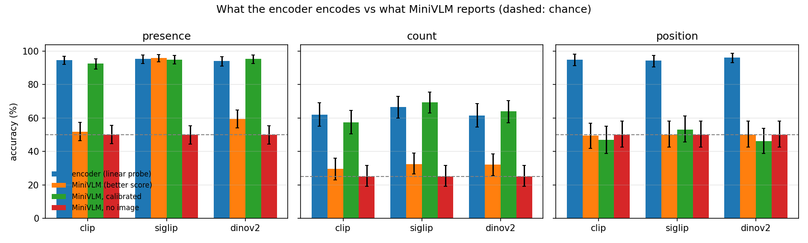
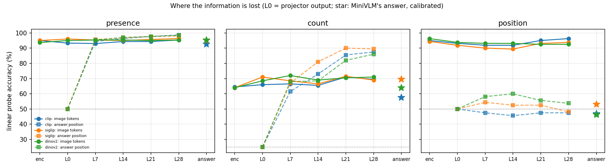
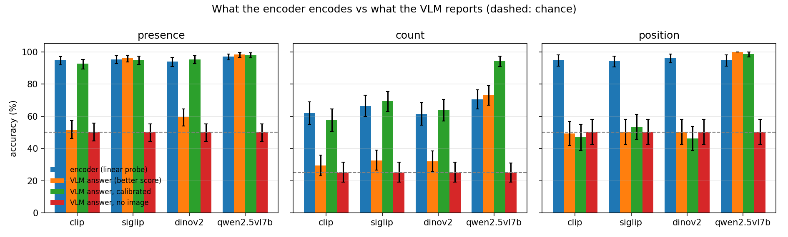
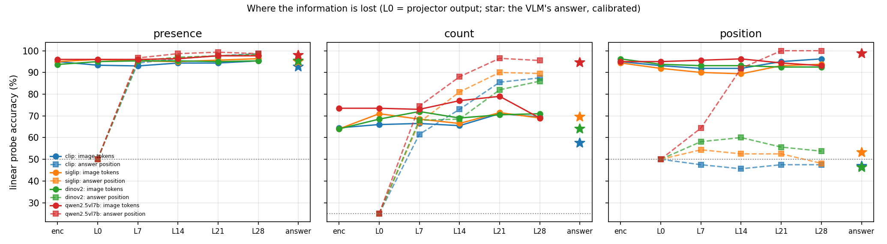

# E1.4: what the encoder sees vs what MiniVLM says

**Stage 1 · Experiment E1.4 · research_stage_01**

For each of the three MiniVLM runs from E1.2 (CLIP, SigLIP and DINOv2 encoders, trainable projector, frozen Qwen2.5-1.5B-Instruct), linear probes measure what the frozen encoder makes available about three simple properties of COCO images. The full model is then asked the same questions about the same images, and the same probes are applied to the projector output and to the LLM's hidden states at five depths. The question: how much of what the encoder encodes reaches MiniVLM's answer, and where does the rest get lost? As a reference, the same probes are run on Qwen2.5-VL-7B, a fully trained VLM with 2-D positional encoding (§7).

---

## Summary

**Roadmap task (E1.4):** linear probes on the frozen encoder's features (object count, relative position) against what the VLM reports. **Success criterion:** a quantitative estimate of the encoder-to-LLM information gap. **Status: met** (§4–6).

**Findings:**

1. **The three encoders encode these properties equally well.** Presence 94–95%, left/right position 94–96%, count 62–74%; no difference between encoders is clear.
2. **Presence: nothing is lost.** MiniVLM's raw accuracy (52% for CLIP, 59% for DINOv2) looked like a 35–43-point gap, but its ranking of the images is as good as the probe's (AUC 98.8–99.0% vs 99.0–99.5%). A per-option offset fitted on 16 images per class brings it to 93–95%. The raw gap was a fixed preference for "Yes".
3. **Count: the LLM computes it, the answer only partly shows it.** A probe on the LLM's state at the answer position reaches **86–90%** at the last layers, better than any linear probe on the encoder (62–74%). MiniVLM's calibrated answer reaches 58–70%: up to 20–30 points are lost at the final readout.
4. **Position: lost at one specific step.** The image-token states keep it at 89–96% through all 28 LLM layers, but the answer-position state stays at chance (46–60%) at every layer, and MiniVLM's AUC is ≈50%. The encoder, the projector and the LLM's image tokens are not the bottleneck; carrying layout from the image tokens to the answer position is.
5. **What reaches the answer behaves like an unordered pool of the image tokens.** "Is there a person anywhere" and "how much person is there" survive; "which side" needs the LLM to relate content to a token's place in the sequence, which neither its text pre-training nor projector-only training on captions asked of it.
6. **Qwen2.5-VL-7B has no gap on any of the three tasks.** Its visual tokens carry position as well as MiniVLM's (95%), but its answer position reaches 100% from layer 21 and it answers left/right correctly for all 160 test images. So the gap is not inherent to VLMs; it comes with MiniVLM's recipe (frozen text LLM, 1-D positions, projector-only training). Which of these matters, this comparison cannot say (§7).

**Quantitative gap (encoder probe minus MiniVLM, percentage points, paired, 95% intervals):**

| Task | Raw answer | Calibrated answer, vs probe at 16 images/class |
|---|---|---|
| Presence | CLIP **+43** [36, 49], SigLIP −1 [−3, 1], DINOv2 **+35** [28, 41] | −19 to −26 (MiniVLM ahead) |
| Count (4 classes) | **+30 to +34** for all three | CLIP −8 [−18, 3], SigLIP **−22**, DINOv2 **−20** (MiniVLM ahead) |
| Position | **+44 to +46** for all three | CLIP **+33** [23, 43], SigLIP **+17** [7, 27], DINOv2 **+35** [26, 44] |
| *Qwen2.5-VL-7B (reference)* | *presence −1, count −3, position −5 (none positive)* | *−15 to −42 (Qwen ahead on all three)* |

The overall conclusion is in §9.

---

## 1 · Why probes, and what a gap means

A **linear probe** is a logistic-regression classifier trained on frozen features. If it predicts a property well, the property is *linearly available* in those features: one weighted sum per answer recovers it. The projector and the LLM are far more powerful than a single linear layer, so if the encoder makes something linearly available and the full model still cannot report it, the information is lost somewhere after the encoder.

Two things can make a model's answer look worse than its information:

- **Readout bias.** With a frozen LLM, MiniVLM may prefer one answer word regardless of the image (E1.2 found the same effect for the stop token). The image can still move the scores in the right direction without ever flipping the answer.
- **Sample efficiency.** A probe is trained on the task; MiniVLM was never trained on these questions. Comparing a probe trained on thousands of images with a zero-shot model is unfair in the probe's favour.

The evaluation therefore reads MiniVLM out three ways (§2.4) and compares at matched training budgets.

---

## 2 · Setup

### 2.1 Tasks

Three questions about people, labelled from the COCO val2017 box annotations:

| Task | Question | Options | Test images | Probe training images |
|---|---|---|---|---|
| presence | Is there a person in the image? | Yes / No | 150 per class (300) | 3,237 |
| count | How many people are in the image? | 0 / 1 / 2 / 3 or more | 50 per class (200) | 3,287 |
| position | Is the person on the left or the right side of the image? | Left / Right | 80 per class (160) | 174 |

**Labels agree across encoders.** CLIP resizes the short side to 224 and crops the centre square, DINOv2 resizes to 256 and crops a tighter 224 square, SigLIP squashes the whole image to 224×224. A person near the edge can be visible to one encoder and missing for another, so each label is computed inside each encoder's view and an image is kept only if the label is unambiguous and identical in all three:

- a person counts if at least half of its box is inside the view and it covers at least 1% of the view;
- images with half-visible or borderline-size people are dropped;
- position is defined only for images with exactly one person, whose centre lies outside the middle 20% of the view.

Test sets are class-balanced and identical for every encoder; all remaining images train the probes. Counts of 4 and 5+ had only 15 usable images each, so the count classes stop at "3 or more".

### 2.2 Encoder probes

The probes read the exact features MiniVLM's projector receives (penultimate encoder layer, 256 patch tokens), pooled two ways:

- **mean:** average over all patches; loses where things are;
- **grid:** average over a 4×4 grid of patch blocks; keeps a coarse layout. This is the primary probe.

Multinomial logistic regression on standardised features, class-weighted, with the L2 penalty chosen by balanced accuracy on a held-out 20% of the training images. A learning curve trains the same probe on 16, 64 and all training images per class.

### 2.3 Probes along the model

The question is put to MiniVLM exactly as in the option scoring, and the frozen LLM's hidden states are read at layers 0, 7, 14, 21 and 28:

- **image tokens (img L*k*):** the 256 image-token states at layer *k*, pooled to the same 4×4 grid. Layer 0 is the LLM's input, i.e. the **projector output**. The image comes before the question and attention is causal, so these states do not depend on the question.
- **answer position (ans L*k*):** the state at the last prompt position, whose output is the first answer token. It has seen the image and the question.

All stages, including a re-trained encoder grid probe, use the same images (up to 500 training images per class, same test set), so the curve shows where a property stops being linearly readable. The answer position at layer 0 is the embedding of the last prompt token, the same for every image, and scores exactly chance as it should.

### 2.4 Reading out MiniVLM

Each option is scored as the answer to "*question*\nAnswer the question using a single word or phrase." in the training chat layout (option likelihood, as in E1.2), with the real image and with a blank image.

| Readout | What it is |
|---|---|
| **raw** | the option with the lowest loss (summed or averaged over its tokens; the better of the two is reported) |
| **calibrated** | loss times a temperature, minus a per-option offset, both fitted on 16 training images per class. Removes a fixed preference for one answer; adds no image information. Compared with the grid probe trained on the same 16 images per class. |
| **AUC** | yes/no and left/right tasks: how well the loss difference between the two options ranks the test images. Needs no threshold, so bias cannot affect it. |

### 2.5 Statistics

Accuracies with 95% percentile bootstrap intervals over test images (5,000 resamples). Gaps and encoder comparisons are paired per image. A difference is called **clear** when its interval excludes zero.

---

## 3 · Main figures



**Figure 1.** Encoder grid probe (blue), MiniVLM's raw answer (orange), calibrated answer (green) and answer without an image (red). Dashed line: chance.



**Figure 2.** Probe accuracy at each stage. Solid lines: image-token states (enc = encoder, L0 = projector output, L7–L28 = LLM layers). Dashed lines: the answer position. Stars: MiniVLM's calibrated answer. Dotted line: chance.

---

## 4 · Results by task

### 4.1 Presence

| | CLIP | SigLIP | DINOv2 |
|---|---|---|---|
| Encoder probe, grid / mean | 94.7 / 95.3 | 95.3 / 96.0 | 94.0 / 96.0 |
| MiniVLM raw | 51.7 [46.3, 57.3] | **96.0** [93.7, 98.0] | 59.3 [54.0, 64.7] |
| — answers "Yes" | 98% | 49% | 91% |
| MiniVLM calibrated | **92.7** [89.3, 95.3] | **95.0** [92.3, 97.3] | **95.3** [92.7, 97.7] |
| AUC, probe / MiniVLM | 99.0 / 98.8 | 99.5 / 98.9 | 99.0 / 99.0 |
| Probe at 16 images per class | 74.0 | 68.7 | 73.3 |
| Answer position, L7 → L28 | 94.3 → 98.7 | 95.7 → 98.0 | 95.3 → 98.3 |

- **Only the bias differs.** CLIP and DINOv2 rank the images almost perfectly but answer "Yes" to nearly everything. In the per-image scores, an image without a person makes "No" cheaper by several nats, but never cheaper than "Yes". The fitted offset in favour of "No" is large for CLIP (10.5) and DINOv2 (7.0), and slightly negative for SigLIP (−0.7), in temperature-scaled loss units.
- **After calibration the encoders are tied** (all paired differences within ±3 points, none clear). SigLIP's raw lead of 37–44 points is entirely calibration.
- **MiniVLM is a better 16-shot learner than the probe** (by 19–26 points): it reuses what the LLM already knows about people and "Yes"; the probe learns from scratch.

### 4.2 Count

| | CLIP | SigLIP | DINOv2 |
|---|---|---|---|
| Encoder probe, grid / mean | 62.0 / 74.0 | 66.5 / 72.5 | 61.5 / 70.5 |
| MiniVLM raw | 29.5 | 32.5 | 32.0 |
| — answers "2" | 89% | 93% | 95% |
| MiniVLM calibrated | 57.5 [50.5, 64.5] | **69.5** [63.0, 75.5] | 64.0 [57.0, 70.5] |
| Probe at 16 images per class | 50.0 | 47.5 | 44.0 |
| Image tokens, L0 → L28 | 66.0 → 69.5 | 71.0 → 69.0 | 68.5 → 71.0 |
| Answer position, L7 → L14 → L21 → L28 | 61.5 → 73.0 → 85.5 → **87.5** | 67.0 → 81.0 → 90.0 → **89.5** | 68.0 → 68.5 → 82.0 → **86.0** |

- **The LLM does real counting.** The answer-position state becomes clearly more informative with depth and ends 12–20 points above any probe on the encoder or on the image tokens. Attention over the image tokens performs an aggregation a single linear layer on pooled patches cannot.
- **The answer does not carry all of it.** Calibrated MiniVLM is 20–30 points below the layer-28 answer-position probe. Part of this is the comparison itself (500 vs 16 training images per class), so the readout loss is somewhere below that range.
- **Raw MiniVLM always says "2"**, about as the blank image does; calibration spreads the answers over all four classes.
- **Encoders:** SigLIP's calibrated count is clearly ahead of CLIP's (+12 [3.5, 21] points); other differences are not clear.
- **Mean beats grid on the encoder** (70–74% vs 62–67%): counting needs no layout, and the grid has 16× more features to overfit.

### 4.3 Position

| | CLIP | SigLIP | DINOv2 |
|---|---|---|---|
| Encoder probe, grid / mean | 95.0 / 56.2 | 94.4 / 46.2 | 96.2 / 50.6 |
| MiniVLM raw (answers "Left") | 49.4 (98%) | 50.0 (100%) | 50.0 (100%) |
| MiniVLM calibrated | 46.9 [38.8, 55.0] | 53.1 [45.6, 61.3] | 46.2 [38.8, 53.8] |
| AUC, probe / MiniVLM | 98.7 / **48.0** | 98.7 / **51.1** | 99.4 / **50.3** |
| Probe at 16 images per class | 79.4 | 70.0 | 81.2 |
| Image tokens, L0 → L28 | 93.1 → 96.2 | 91.9 → 93.8 | 93.8 → 92.5 |
| Answer position, L7 / L14 / L21 / L28 | 47.5 / 45.6 / 47.5 / 47.5 | 54.4 / 52.5 / 52.5 / 48.1 | 58.1 / 60.0 / 55.6 / 53.8 |

- **The mean probe at chance confirms the setup**: averaging all patches destroys layout, so the task genuinely needs spatial information.
- **The position information is easy to read** from the encoder (70–81% with 16 images per class) and stays in the image tokens through the whole LLM.
- **It never reaches the answer position.** Only DINOv2 at layer 14 is slightly above chance (60.0 [52.5, 67.5]). MiniVLM's scores carry no signal (AUC ≈ 50%), so calibration cannot help.

---

## 5 · Where the information goes

| Stage | Presence | Count | Position |
|---|---|---|---|
| Encoder (grid probe) | 94–95 | 64–65 | 94–96 |
| Projector output (img L0) | 93–96 | 66–71 | 92–94 |
| LLM image tokens, L28 | 95–96 | 70–71 | 93–96 |
| LLM answer position, L28 | 98–99 | 86–90 | 48–54 |
| MiniVLM, calibrated | 93–95 | 58–70 | 46–53 |

(Stage probes on the same images, up to 500 training images per class; the encoder row differs slightly from §4, which uses all training images.)

- **The projector loses nothing measurable** on any task (img L0 within 1–3 points of the encoder, sometimes above it).
- **The LLM's image tokens keep everything** through all 28 layers.
- **The decisive step is from the image tokens to the answer position.** For presence and count it adds information; for position it removes all of it.
- **The final readout** is lossless for presence once calibrated, and loses part of count.

---

## 6 · Comments and interpretation

**Why position, and not presence or count?** Presence and count do not depend on the order of the image tokens: shuffle the 256 tokens and the answer stays the same. Attention from the answer position can compute both as a pooled summary ("is any token a person", "how many tokens look like people"). Left vs right is defined by *which* tokens contain the person, i.e. by their place in the sequence. The LLM does receive that place through its 1-D positional encoding, but it was trained on text, where "the first 128 of these tokens are the left half of a picture" never occurs, and the projector was trained only on captions and conversations, which rarely ask where something is. Nothing ever taught the answer position to read the 2-D layout of the image block.

**A caveat on the image-token probes.** The grid pooling gives the probe the layout for free: a token's cell is known from where it sits. A high score there shows that each token still carries its own content, not that the LLM represents layout. The meaningful result is that the answer position — the only place the answer can come from — has no access to it.

**Link to E1.2.** MiniVLM's MMVP pair accuracy was 3–10%, far below chance, and many MMVP pairs hinge on orientation, direction or spatial relations. This experiment points to the reason: the encoders capture such distinctions, but MiniVLM's answer path pools the image without its layout.

**The method lesson (again).** A frozen LLM's answer word preferences can hide almost all of the image information in raw accuracy: CLIP's presence accuracy goes from 52% to 93% with two fitted numbers. Option-likelihood comparisons between encoders should report AUC or a calibrated readout, not only argmax accuracy. This also qualifies the E1.2 conclusions (see that report).

**What this suggests for later stages.** Layout reaches the LLM but is not used, so the remedy is in training or positional design rather than in a better encoder or a bigger projector: training data that asks for positions and spatial relations, unfreezing (or LoRA on) the LLM, or 2-D positional information for image tokens, as Qwen2-VL's M-RoPE provides. All three are cheap to test with the same probes.

---

## 7 · Reference: Qwen2.5-VL-7B

Is the position gap a property of VLMs in general, or of MiniVLM's recipe? The same tasks, test images, calibration images, stage-probe images and readouts were run on **Qwen2.5-VL-7B-Instruct**, the model of E1.3. It differs from MiniVLM in several ways at once: its vision encoder and language model were trained together on large multimodal data including grounding, its visual tokens carry 2-D positions (M-RoPE), and its LLM has 7B parameters instead of 1.5B.

**Setup differences.**
- Each image is resized to 448×448 px, which gives 16×16 = 256 visual tokens, as in MiniVLM, so the tokens can be pooled to the same 4×4 grid. Squashing to a square is SigLIP's view, in which every label was already checked, so the labels remain valid.
- The "encoder" stage is Qwen's visual tokens after its 2×2 patch merger, i.e. what its LLM receives; it is therefore identical to layer 0 (both score the same, as expected).
- Questions and short-answer prompt are worded as for MiniVLM, inside Qwen's own chat template.



**Figure 3.** As Figure 1, with Qwen2.5-VL-7B as a fourth model.



**Figure 4.** As Figure 2, with Qwen2.5-VL-7B in red.

### 7.1 Results

| | Presence | Count | Position |
|---|---|---|---|
| Visual-token probe, grid | 97.0 | 70.5 | 95.0 |
| Raw answer | **98.3** | 73.0 | **100.0** |
| — answer distribution | Yes 52% | never "3 or more" | Left 50% |
| Calibrated answer | 98.0 | **94.5** | 98.8 |
| AUC, probe / answer | 99.2 / 99.8 | — | 99.1 / **100.0** |
| Gap, probe − raw answer | −1.3 [−3.7, 1.0] | −2.5 [−8.0, 3.0] | −5.0 [−8.8, −1.9] |
| Image tokens, L0 → L28 | 96.0 → 97.7 | 73.5 → 69.0 | 95.0 → 93.1 |
| Answer position, L7 / L14 / L21 / L28 | 96.7 / 98.7 / 99.3 / 98.7 | 74.5 / 88.0 / 96.5 / 95.5 | 64.4 / 91.9 / **100.0** / **100.0** |

**Position, side by side:**

| Stage | MiniVLM (3 encoders) | Qwen2.5-VL-7B |
|---|---|---|
| Visual tokens (encoder / L0) | 92–96 | 95 |
| Image tokens, L28 | 92–96 | 93 |
| Answer position, L7 / L14 / L21 / L28 | 46–60 at every layer | 64 / 92 / 100 / 100 |
| Answer: raw / calibrated / AUC | ≈50 / 46–53 / ≈50 | 100 / 99 / 100 |

### 7.2 What it shows

- **Same information in, different routing.** Qwen's visual tokens carry position about as well as MiniVLM's (95% vs 92–96%). The whole difference lies in the step from the image tokens to the answer position, which confirms §5's localisation: in Qwen this step works, in MiniVLM it does not.
- **The routing happens in the middle layers.** In Qwen, position becomes readable at the answer position between layers 7 and 21 (64% → 92% → 100%).
- **Presence and count reach the answer fully.** Presence is near-perfect without any bias. For count, the answer-position probe reaches 96.5%, and the calibrated answer 94.5%: no readout loss once the bias is removed.
- **Answer bias exists in Qwen too.** Raw count accuracy is 73% because Qwen never answers "3 or more"; one fitted offset lifts it to 94.5%. Calibrated or threshold-free readouts are needed even for strong models.
- **Late image tokens lose what was already routed.** Qwen's image-token count probe falls from 79% at L21 to 69% at L28, after the answer position has taken what it needs.

**What it does not show.** Qwen differs from MiniVLM in training (joint, multimodal, with grounding data), positional encoding (M-RoPE), LLM size and input resolution, so this run cannot tell which of these closes the gap. Qwen has also very likely seen COCO images during training, so its near-perfect scores may be partly memorisation.

---

## 8 · Caveats

- **One seed per encoder; one COCO category.** People are by far the most common COCO category; rarer categories may behave differently, especially for presence.
- **Few test images for position (160) and count (200).** Intervals are ±7–8 points; small encoder differences are not resolved.
- **Count labels are noisy at the top.** COCO boxes miss people, and "3 or more" merges very different scenes; the probe accuracies for count are modest for every method.
- **The readout gap for count is an upper bound.** The answer-position probe uses up to 500 training images per class, the calibration 16.
- **Linear probes measure linear availability.** A property a probe cannot find might still be present nonlinearly; the claims here are about what a linear readout — like the LM head — can use.
- **Only the projector was trained.** The results describe MiniVLM, not VLMs in general; §7 shows that a jointly trained model does route layout to the answer on this task.

---

## 9 · Conclusion

E1.4 asked how much of what a frozen vision encoder encodes reaches a VLM's answer. For MiniVLM, the answer depends on the kind of property:

- **Order-independent properties reach the answer.** Presence survives completely once a fixed answer bias is removed; count is even computed more accurately inside the LLM than any linear probe on the encoder can read it, though part of it is lost at the final answer.
- **Layout does not.** Left/right position is encoded at 94–96% by all three encoders, survives the projector and every LLM layer in the image tokens, and is at chance at the answer position and in the answer. The quantitative encoder-to-answer gap for position is **44–46 points** raw and **17–35 points** against a probe with the same 16 training images per class.
- **The loss is localised.** Not the encoder, not the projector, not the image-token states, but the transfer from the image tokens to the answer position.
- **It is not inherent to VLMs.** Qwen2.5-VL-7B, with the same position information in its visual tokens, routes it to the answer completely. The gap is a consequence of MiniVLM's recipe: a frozen text LLM with 1-D positions, aligned only through a projector trained on captions and conversations.
- **Measurement matters.** Raw argmax accuracy confounded answer bias with missing information for both models (CLIP presence 52% → 93%, Qwen count 73% → 94.5% with calibration). AUC and calibrated readouts separate the two.

For the Stage 1 question of where visual detail is lost: E1.3 located the first place (the input resize, for reading tasks), and E1.4 the second (routing inside the language model, for layout, when only the projector is trained). Which ingredient of full training closes the second gap is left open by this experiment.

---

## 10 · Reproducing it

```bash
python scripts/18_bottleneck_probe.py        # MiniVLM runs; builds tasks.json
python scripts/19_bottleneck_probe_qwen.py   # Qwen2.5-VL-7B reference (§7), after script 18
```

- Settings are in the `probe` section of `config.yaml` (category, label rules, test sizes, learning-curve sizes, `calib_per_class`, `llm_layers`, `layer_train_per_class`).
- It downloads COCO's annotation file and the val2017 images the tasks use, and needs the three trained main runs. Re-running reuses finished runs and cached encoder features; results written with other tasks or settings are recomputed.
- Results: `<runs_dir>/e1_4_probe/` with `tasks.json` (labels and splits), `results_<encoder>.json` (per-image predictions and option losses), `summary.json`, `bottleneck_probe.png` and `information_by_stage.png`.
- The Qwen run reads `tasks.json` and the settings in `probe.qwen` (model, 448 px image size, layers, batch size; about 17 GB of GPU memory in bf16, so an L4 is enough). It writes `results_qwen2.5vl7b.json`, and `summary_qwen2.5vl7b.json`, `bottleneck_probe_qwen2.5vl7b.png` and `information_by_stage_qwen2.5vl7b.png` with the MiniVLM runs alongside.

| File | What it contains |
|---|---|
| `e1_4/tasks.py` | Encoder view geometry, labels inside each view, cross-view consistency, balanced splits. |
| `e1_4/probe.py` | Patch pooling (mean, grid) and the logistic-regression probe. |
| `e1_4/llm_probe.py` | Image-token and answer-position hidden states of the frozen LLM. |
| `e1_4/run.py` | Driver: tasks, features, probes, MiniVLM option scoring, stage probes. |
| `e1_4/analysis.py` | Calibration, AUC, paired gaps, stage accuracies, figures. |
| `e1_4/qwen.py` | The same probes and readouts for Qwen2.5-VL at a fixed image size. |

---

## 11 · Next steps

- **Stage 1 gate:** E1.4 provides the quantitative encoder-to-LLM gap; what remains is the reading item (three architectural decisions where Qwen2.5-VL and InternVL3 diverge). M-RoPE versus 1-D positions is a natural candidate, given §7.
- **Candidate thesis problem:** [candidate_thesis_problem.md](candidate_thesis_problem.md), revised after the Qwen result: which ingredient of VLM design and training makes visual layout reach the answer position, and how that routing is implemented.
- **Optional follow-ups, outside Stage 1:** harder spatial relations (above/below, relations between two objects) on Qwen2.5-VL; MiniVLM with spatial questions in training, 2-D position embeddings or LoRA; a second COCO category and a second seed.
