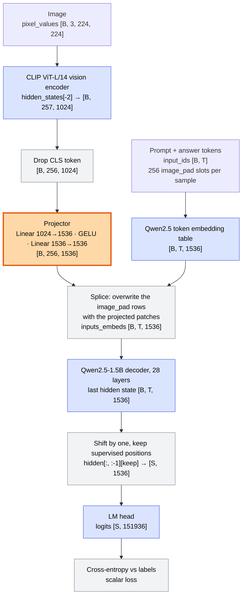
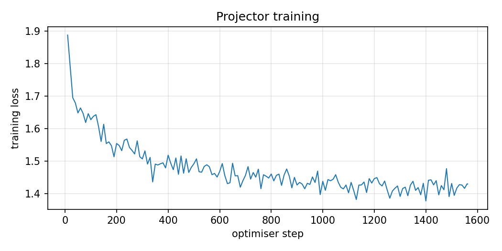
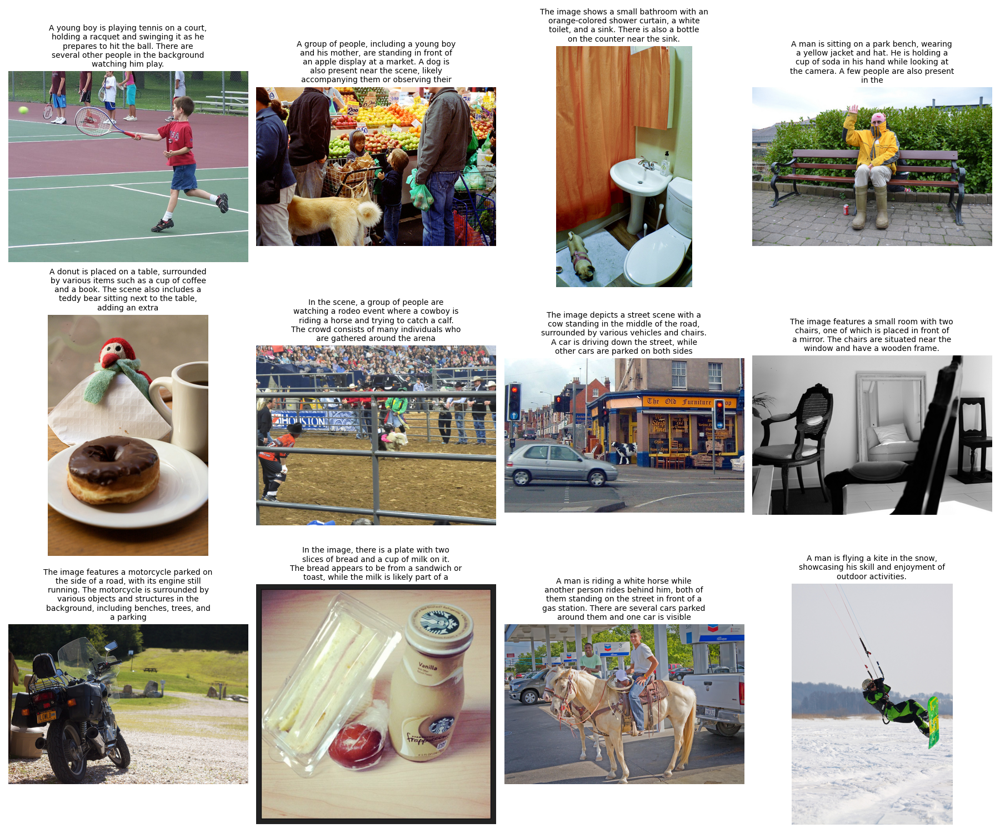
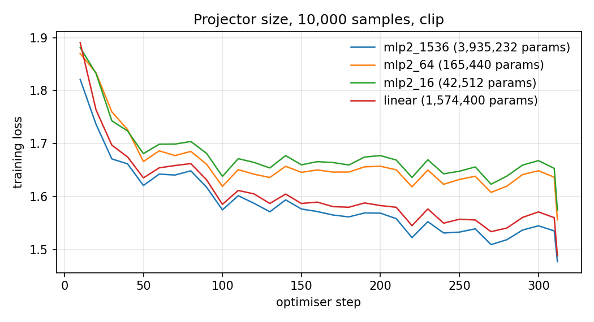

# MiniVLM: a hand-built vision-language model, explained

**Stage 1 · Experiments E1.1 and E1.2 · research_stage_01**

Frozen vision encoder → trainable projector → frozen Qwen2.5-1.5B-Instruct, trained on 50k LLaVA-Instruct samples with COCO images. This document covers the completed main runs (E1.1), the projector-size ablation that closes the E1.1 gate, and the vision-encoder comparison CLIP vs SigLIP vs DINOv2 (E1.2), including every evaluation run on them.

> **Figures.** Two figures are produced by the pipeline and live on Google Drive. Copy them into `docs/figures/` to have them render here: `main_clip_qwen1.5b/loss.png` → `figures/loss_clip.png` (script 07) and `main_clip_qwen1.5b/captions_grid.png` → `figures/captions_grid_clip.png` (script 10). The projector-ablation plot is already in the repository.

---

## Summary

The codebase builds the smallest complete version of the LLaVA recipe. A pretrained image encoder turns a photo into 256 feature vectors. A small trainable network, the **projector**, translates those vectors into the word-embedding space of a pretrained LLM. The LLM then reads them exactly as if they were 256 extra words in its prompt. Only the projector is trained: 3.94M parameters, about 0.2% of the whole system.

| | |
|---|---|
| **3.94M** trainable parameters | projector only (CLIP version) |
| **1.89 → 1.42** training loss | first logged step → mean of the last 20 logged values, 1,562 steps |
| **1.64 vs 2.02** held-out loss | correct image vs a wrong photo, on 500 unseen descriptions |
| **13.9 GB** peak GPU memory | on an L4, about 10.6 samples/s, about 78 min per run |

**Status against the roadmap:**

| Experiment | Success criterion | Status |
|---|---|---|
| E1.1 Minimal VLM | coherent, image-grounded captions; every tensor shape at the interface explained | **Met** (§2, §4) |
| E1.1 gate: "know what breaks when the projector is too small" | — | **Met** by the projector-size ablation (§5) |
| E1.2 Encoder ablation | which encoder wins on which task type, with a hypothesis | **Met**: five task types, format-controlled measures (§6) |

**Headline findings:**

1. The model is grounded: the same held-out text costs 1.64 nats/token with the right image, 1.93 with a grey image and 2.02 with a wrong photo.
2. A projector with a 64- or 16-wide hidden layer carries almost no image information: the grounding gap falls by over 90% and A-OKVQA accuracy drops to the no-image level, while training loss rises only about 0.1. Training loss alone hides this.
3. A linear projector is nearly as good as the two-layer MLP at this scale.
4. **SigLIP** gives the frozen LLM the most image-specific information on every format-controlled measure: detailed descriptions, the words of short captions, MMVP fine-grained pairs, and A-OKVQA (tied with CLIP).
5. With a frozen LLM, swapping the encoder (or the projector) also changes the LLM's **output-format prior**, above all how willing it is to stop after one sentence. Generated-caption metrics and absolute likelihood mix this with visual information; CLIP's lead on short captions is about 70–86% this effect. Grounding gaps and option likelihood separate the two.

**What changed since the first write-up** (the PDF guide):
- *"CIDEr mostly follows caption length"* holds for DINOv2 vs CLIP, but not for SigLIP, which stays clearly last on first sentences (§6.4).
- The caption-length problem is **verbosity, not truncation**: raising the token limit from 40 to 96 left CIDEr unchanged (§4.3).
- *"DINOv2 ≈ CLIP"* is refined: DINOv2 carries more image-specific information than CLIP on short captions, and less usable information on A-OKVQA (§6.5–6.7).
- The SigLIP generation gap is explained: it comes from the stop token, not missing visual information (§6.5).

---

## 1 · Vocabulary, with concrete examples

Shapes are written as `[B, T, D]`: B = how many samples in the batch, T = how many positions per sample, D = how many numbers describe each position.

**Token.** The unit the LLM reads: a word, a piece of a word, or a special marker. *"The cat is sleeping."* becomes roughly `The` `␣cat` `␣is` `␣sleeping` `.`. Each token has an integer id; Qwen's vocabulary has **151,936** ids.

**Embedding / hidden size.** The LLM looks up each token id in a table and gets a vector of **1536** numbers (Qwen2.5-1.5B's hidden size). CLIP's vectors have **1024** numbers. The projector exists because 1024 ≠ 1536 and, more importantly, because the two spaces mean different things.

**Patch.** A Vision Transformer (ViT) treats an image like a sentence of squares. A 224×224 image cut into 14×14-pixel squares gives 224/14 = 16 squares per side, so **16 × 16 = 256 patches**. Each patch becomes one token for the vision transformer.

**CLS token.** "Classification" token. ViT prepends one extra learned token to the 256 patches, so the encoder's sequence has **257** positions. Through attention, CLS gathers a summary of the whole image; CLIP was trained to align that summary with a caption. MiniVLM **drops it** (position 0) and keeps the 256 patch tokens, because the LLM benefits more from *where* things are than from one global summary. This is what `num_prefix_tokens=1` means in `config.py`; SigLIP has no CLS, so its value is 0.

**Hidden states and the penultimate layer (`feature_layer = -2`).** CLIP ViT-L has 24 transformer layers. With `output_hidden_states=True` it returns 25 snapshots: the input embeddings plus the output of each layer. Index −2 is the output of layer 23, the second to last. LLaVA reported that this layer works better than the last one, whose features CLIP tuned towards global, caption-level properties.

**Sequence length T.** Number of token positions per sample after padding. A sample is: system prompt + **256 image slots** + question + answer (+ follow-up turns). Text is capped at `max_text_tokens = 256`, so a sample is at most 256 + 256 = **512** positions. In the measured batch T = 482: the longest sample had 256 image slots and 226 text tokens.

**Padding and attention mask.** Samples in one batch have different lengths, but a tensor must be rectangular, so the `Collator` right-pads every sample to the longest one with a pad token. `attention_mask` is 1 for real tokens and 0 for padding, so the LLM ignores the padding.

**`<|image_pad|>` placeholder and the splice.** The text contains 256 copies of a special token `<|image_pad|>` between `<|vision_start|>` and `<|vision_end|>`. They reserve seats. After embedding, those 256 rows are **overwritten** by the 256 projected patch vectors (`masked_scatter`). The LLM never sees the placeholder's own embedding.

**Labels and −100.** `labels` has the same shape as `input_ids`. It holds the token id where we want the model to learn, and −100 ("ignore") everywhere else: system prompt, image slots, the user's question, padding. PyTorch's cross-entropy skips −100.

**Supervised positions, S.** The positions that actually produce a loss: the assistant's answer tokens and the closing `<|im_end|>` that teaches the model to stop. S counts them across the whole batch. In the measured batch, S = 433 of 4 × 482 = 1,928 positions, about 22%.

**Next-token shift.** The hidden state at position *t* predicts the token at position *t+1*, so the code pairs `hidden[:, :-1]` with `labels[:, 1:]`.

**Logits, cross-entropy, perplexity.** The LM head turns a 1536-vector into 151,936 scores (logits), one per possible next token. Cross-entropy is −log(probability given to the correct token), averaged over supervised tokens, in nats. A loss of 1.64 means perplexity e^1.64 ≈ 5.2: on average the model is about as unsure as if picking among 5 equally likely tokens.

Terms used in the evaluation sections:

**Grounding gap.** The loss on the *same* text with a wrong (or blank) image minus the loss with the correct image. It measures how much the image helps, separately from how predictable the text is on its own. Higher means more grounded.

**Teacher-forced likelihood.** Feeding the model a fixed text (for example a human caption) and measuring the loss of each token given the previous ones, instead of letting it generate. No decoding choices are involved.

**Option likelihood.** For a multiple-choice question, each option is scored as the model's answer, and the option with the lowest loss is the prediction. Every option has the same format, so preferences about length or style largely cancel.

**Format prior.** What the frozen LLM tends to write regardless of the image: paragraph vs one sentence, typical phrases, when to stop. In this setup it depends on the projector and encoder, because their tokens condition the LLM even when they carry little image information.

**Paired bootstrap interval.** All runs are evaluated on the same items. A difference between two runs is computed item by item, then items are resampled 5,000 times to get a 95% interval. A difference is **clear** when its interval excludes zero.

---

## 2 · The architecture, step by step



*Figure 1. Data flow with tensor shapes. Blue: frozen weights. Orange: trained weights. Grey: operations without weights. B = samples in the batch, T = padded sequence length, S = supervised positions in the batch. The gradient flows back through the frozen LLM to the projector.*

### The three parts

| Part | Status | What it does, in plain words |
|---|---|---|
| **CLIP ViT-L/14** (`openai/clip-vit-large-patch14`) | frozen | The "eyes". Cuts a 224×224 image into a 16×16 grid of 14-pixel patches and describes each patch with a 1024-number vector. |
| **Projector** (Linear → GELU → Linear) | trained | The "translator". Maps each 1024-number patch vector to a 1536-number vector that lives in the LLM's word-embedding space. |
| **Qwen2.5-1.5B-Instruct** | frozen | The "writer". A 28-layer decoder that reads the text tokens plus the 256 translated patches and predicts the answer one token at a time. |

**Why freeze almost everything?** This is LLaVA's "stage 1" (feature alignment). Both big models already know a lot; the only missing piece is a dictionary between CLIP's vector space and Qwen's. Training only the dictionary is cheap (one epoch fits on a single 22 GB L4 in under 1.5 hours), and it isolates one question cleanly: *can a small adapter make a frozen LLM use visual information?* The grounding test in §4.1 answers yes.

### Steps 1–3: from pixels to 256 patch vectors

1. **Preprocess.** The CLIP image processor resizes the shorter side to 224, centre-crops 224×224 and normalises colours. One image is `[3, 224, 224]` (RGB × height × width); a batch of 4 is `[4, 3, 224, 224]`.
2. **Encode.** CLIP cuts it into 256 patches, adds the CLS token and runs 24 layers. We read layer −2: `[4, 257, 1024]`. This runs under `torch.no_grad()` in fp16, so CLIP stores no activations for backpropagation.
3. **Drop CLS.** `hidden[:, 1:]` → `[4, 256, 1024]`. Row 0 of the result is the top-left patch, row 15 the top-right, row 255 the bottom-right (row-major order).
4. **Project.** Each of the 256 rows goes through the same MLP: `x(1024) → Linear → 1536 → GELU → Linear → 1536`. Parameters: (1024×1536 + 1536) + (1536×1536 + 1536) = **3,935,232**. Output `[4, 256, 1536]`: now the same width as a Qwen word embedding.

### Step 4: the text sequence, with seats reserved for the image

Every sample is written in Qwen's ChatML chat format by hand in `minivlm/data.py`, so the code knows exactly which tokens are supervised. One real training sequence, with the 256 image slots collapsed:

```text
<|im_start|>system
You are a helpful assistant.<|im_end|>
<|im_start|>user
<|vision_start|><|image_pad|>×256<|vision_end|>
What is this photo about?<|im_end|>
<|im_start|>assistant
The image features a group of people gathered together in a cozy living room …<|im_end|>
```

The 256 `<|image_pad|>` seats are overwritten by the image. Only the assistant's answer and its closing `<|im_end|>` carry a loss. Multi-turn conversations add further user/assistant turns *without* another image block; every assistant answer is supervised, no user turn is.

### A toy batch you can check by hand

To see padding, the splice and supervised positions all at once, shrink the image to **4** seats instead of 256 and use a batch of **B = 2** short conversations. (The unit tests in `tests/test_shapes.py` do exactly this with a tiny random CLIP and Qwen: 28-px images give 2×2 = 4 patches.) For readability each word is one token.

| position *t* | 0 | 1 | 2 | 3 | 4 | 5 | 6 | 7 | 8 | 9 | 10 | 11 |
|---|---|---|---|---|---|---|---|---|---|---|---|---|
| A: input_ids | user | v_start | IMG | IMG | IMG | IMG | v_end | What? | assist. | A | cat | im_end |
| A: labels | −100 | −100 | −100 | −100 | −100 | −100 | −100 | −100 | −100 | **A** | **cat** | **im_end** |
| B: input_ids | user | v_start | IMG | IMG | IMG | IMG | v_end | What? | assist. | Dog | im_end | PAD |
| B: labels | −100 | −100 | −100 | −100 | −100 | −100 | −100 | −100 | −100 | **Dog** | **im_end** | −100 |
| B: attention_mask | 1 | 1 | 1 | 1 | 1 | 1 | 1 | 1 | 1 | 1 | 1 | 0 |

Sample A has 12 tokens and B has 11, so T = 12 and B gets one PAD. Following the shapes (real widths, toy lengths):

| Tensor | Toy shape | What happened |
|---|---|---|
| `input_ids` | `[2, 12]` | two rows of token ids, padded to the longest |
| text embeds | `[2, 12, 1536]` | every id looked up in Qwen's table, IMG seats included |
| projector output | `[2, 4, 1536]` | 4 patch vectors per image |
| `inputs_embeds` after splice | `[2, 12, 1536]` | rows 2–5 of each sample replaced by that sample's own 4 patches; shape unchanged |
| LLM last hidden state | `[2, 12, 1536]` | one contextual vector per position |
| `hidden[:, :-1]`, `labels[:, 1:]` | `[2, 11, 1536]`, `[2, 11]` | shift: position *t* is paired with the token at *t+1* |
| keep supervised | `[5, 1536]` | A: positions 8→"A", 9→"cat", 10→im_end (3). B: 8→"Dog", 9→im_end (2). **S = 3 + 2 = 5** |
| logits | `[5, 151936]` | a score for every vocabulary entry at those 5 positions only |
| loss | scalar | mean of the 5 per-token cross-entropies |

**Notice position 8.** The hidden state at the "assistant" token, the last thing before the answer, is where the model must predict the *first* answer word. That position has seen the image through attention over rows 2–5, so predicting "A" vs "Dog" correctly is only possible if the projected patches carry usable information. That gradient is what trains the projector.

### Steps 5–8: the real shapes, measured on one real batch

`scripts/04_trace_shapes.py` runs one forward pass with B = 4 real samples and records every shape. The result was **T = 482** and **S = 433**:

| Tensor | Shape | Reading the numbers |
|---|---|---|
| `pixel_values` | `[4, 3, 224, 224]` | 4 RGB images, 224×224 |
| encoder `hidden_states[-2]` | `[4, 257, 1024]` | 1 CLS + 16×16 patches, CLIP width 1024 |
| patch features | `[4, 256, 1024]` | CLS dropped |
| projector output | `[4, 256, 1536]` | now in Qwen's embedding space |
| `input_ids` | `[4, 482]` | longest sample = 256 image seats + 226 text tokens; shorter ones padded |
| text embeds | `[4, 482, 1536]` | embedding lookup |
| `inputs_embeds` after splice | `[4, 482, 1536]` | 4 × 256 = 1,024 rows overwritten in total |
| LLM last hidden state | `[4, 482, 1536]` | after 28 decoder layers |
| `labels` | `[4, 482]` | −100 everywhere except answer tokens |
| logits | `[433, 151936]` | supervised positions only, not `[4, 482, 151936]` |

### Why compute logits only at supervised positions?

The vocabulary is huge, so the logits are the largest tensor in the model. For this batch:

| Variant | Elements | bf16 | fp32 copy for the loss |
|---|---|---|---|
| All positions `[4, 482, 151936]` | 292.9M | 586 MB | 1.17 GB |
| Supervised only `[433, 151936]` | 65.8M | 132 MB | 263 MB |

78% of positions (system prompt, 256 image seats, questions, padding) carry no loss, so computing their logits is pure waste. Skipping them is 4.5× smaller here, and it was part of what let batch size 8 fit on the L4. The unit test `test_loss_matches_full_vocabulary_loss` checks that the result is numerically identical to Hugging Face's standard full-sequence loss.

### Why does a frozen LLM still use most of the GPU memory?

The projector sits *before* the LLM. To compute ∂loss/∂projector, the gradient must travel backwards through all 28 Qwen layers to reach `inputs_embeds`. Backpropagation needs each layer's activations, so they are stored during the forward pass even though Qwen's weights never get gradients (`requires_grad=False`). CLIP is different: it sits before the projector and runs under `no_grad`, so nothing of it is kept. Peak memory was 13.9 GB for B = 8; B = 16 ran out of memory on the 22 GB L4. Gradient checkpointing (`--grad_checkpointing`) would trade speed for memory.

### Generation at test time

For captioning, `build_prompt` produces the same layout but stops right after `<|im_start|>assistant\n`. `MiniVLM.generate` does the splice and hands `inputs_embeds` to Qwen's `generate`, which decodes greedily (no sampling) until `<|im_end|>` or the token limit.

---

## 3 · Data and training

### Training data

A 50k subset of **LLaVA-Instruct-150K**, using COCO train2017 images (only the needed images are downloaded):

- **~23k detail descriptions** (46%): "Describe the image in detail" → a paragraph.
- **~27k conversations**: several question/answer turns about one image.
- **500 held-out** detail descriptions, split *by image*: no held-out image appears in training, not even in a conversation.

**Truncation.** Text is capped at 256 tokens per sample (image seats not counted). Whole turns are kept while they fit; a later turn that does not fit is dropped; if even the first answer is too long, it is cut at the budget.

### Settings of the run (`config.json`)

| Setting | Value |
|---|---|
| Optimiser | AdamW, lr 1e-3, weight decay 0 |
| Schedule | linear warmup 3% (46 steps), then cosine to 0 |
| Batch | 8 per forward × 4 accumulation = **32** effective |
| Length | 1 epoch = **1,562** optimiser steps (49,984 samples) |
| Stability | gradient clipping at norm 1.0; bf16 autocast |
| Speed / memory | ≈10.6 samples/s (≈78 min of training), 13.9 GB peak |

**Gradient accumulation:** 8 samples fit in memory, but updates are based on 32. The code runs 4 forward/backward passes, adds up the gradients (each loss divided by 4), then takes one optimiser step. "Step" in the log always means an optimiser step = 32 samples. **Warmup:** the projector starts random, so a full learning rate on step 1 could produce wild updates; the rate rises from 0 to 1e-3 over 46 steps (the logged lr at step 10 is 2.17e-4 = 1e-3 × 10/46). **Cosine decay** then lowers it smoothly to about 0 by the last step. **Resumable:** the data order per epoch is a seeded permutation, so a restarted run skips exactly the batches already done.



*Figure 2. Training loss, averaged over each 10 optimiser steps (`train_log.csv`, plotted by script 07).*

### Reading the curve

The loss falls fast in the first ~50 steps (1.89 → 1.65) while the projector learns a rough mapping, then slowly to about **1.42** (mean of the last 20 logged values). After step ~1,000 it is nearly flat while the learning rate decays: one epoch with a frozen LLM is close to what this projector can reach. The step-to-step noise (±0.03) comes from batch content, since detail descriptions and conversations differ in difficulty. No spikes and no divergence, so warmup and clipping did their job.

Even 1.89 at the start is not "random": the frozen Qwen already predicts fluent English well, and the visual tokens only help with image-specific words. That is why §4.1 compares losses with and without the right image. §5 shows that a large part of the early drop is not image information at all.

---

## 4 · E1.1 results

### 4.1 Grounding control: is the LLM actually looking at the image?

A low loss alone does not prove the model uses the picture: a strong LLM can write a plausible "detailed description" of a typical COCO scene without seeing anything. The control (`eval grounding`, script 08) takes the 500 held-out descriptions and computes the loss on the same answer text three times, changing only the image:

- **correct:** the true image.
- **shuffled:** another held-out sample's image (the batch rolled by one), a real photo that does not match the text.
- **blank:** all-zero `pixel_values`. After CLIP normalisation, zero is the dataset's mean colour, so this is a flat grey image: "no information".

| Image given | Loss (nats/token) | Perplexity | vs correct |
|---|---|---|---|
| **correct** | **1.643** | **5.17** | — |
| blank (grey) | 1.925 | 6.86 | +0.28 |
| shuffled (wrong photo) | 2.019 | 7.53 | +0.38 |

*Token-weighted over 61,862 supervised tokens (≈124 per description). Source: `grounding.json`.*

**Interpretation.** The model is clearly grounded: the same text becomes much less likely when the image is wrong. With the correct image the model is as uncertain as choosing among ~5 tokens; with a wrong image, ~7.5.

1. **Shuffled is worse than blank.** A wrong photo is actively misleading (the model expects a dog, the text talks about a kitchen), while a grey image only removes information. This ordering is what we would expect from a model that really reads the visual tokens.
2. **Blank still scores 1.925, well below a pure guess.** That part is the frozen LLM's language prior: COCO descriptions are predictable ("The image features…", "In addition to…"). The 0.28-nat gap between blank and correct is what the image contributes on top of that prior.

**Why is held-out loss (1.64) higher than the final training loss (1.42)?** Partly the usual train/test gap, but the two numbers are not measured on the same kind of data. The held-out set is only detail descriptions (long, open-ended paragraphs, hard to predict word by word), while training mixes in conversations, whose short factual answers are easier. A fair over-fitting check would compare against training loss on detail descriptions only; the code does not log that split. With a 3.9M-parameter projector, one epoch and a frozen LLM, strong over-fitting is unlikely.

### 4.2 Captions on COCO val2017 (200 unseen images)



*Figure 3. First 12 images with the answer to "Describe the image in one short sentence." (greedy decoding). Produced by script 10.*

**What works.** The main subject and scene are right in most images: boy playing tennis, small bathroom with an orange shower curtain, man in a yellow jacket on a park bench, rodeo crowd, motorcycle by a road, a cow figure on a street with cars. Colours and clothing are often correct, so the projector carries fine visual detail, not just a scene category.

**Typical errors.** Object identity slips: the Starbucks Frappuccino bottle becomes "a cup of milk" (and "a bottle of Coke" in the detailed answer); the kite-boarder is "flying a kite"; the pug in the bathroom is missed. The detailed answers hallucinate more, in the LLaVA style: the two horse riders at the gas station become "a group of people standing around a motorcycle", and the donut scene gains "a cupcake, a cookie, and a bottle of soda" that are not there.

| Caption statistic (40-token limit, first evaluation) | Value |
|---|---|
| CIDEr, short prompt (simple tokeniser) | **0.097** |
| Mean length, model "short" caption | 30.0 words |
| Mean length, COCO reference caption | 10.5 words |
| Short captions cut off by the 40-token limit | 68 / 200 |
| Mean length, detailed answer | 93 words |

### 4.3 The caption-length problem: verbosity, not truncation

The model ignores "one short sentence" and writes LLaVA-style paragraphs, three times longer than COCO references. That is expected: the projector was trained only on long descriptions and conversations, never on short captions, and the frozen LLM has not been instruction-tuned for images.

To separate the effects, the caption evaluation now reports three CIDEr variants, each with a 95% bootstrap interval over images: on the **whole** short caption, on its **first sentence** only, and on captions that **finished** before the token limit. The short-caption token limit was raised from 40 to 96 (`eval.short_max_new_tokens`), and whether each caption finished is read from generation (did it emit `<|im_end|>`).

| CIDEr, CLIP | 40-token limit | 96-token limit |
|---|---|---|
| Whole caption | 0.097 | 0.097 [0.068, 0.131] |
| First sentence only | 0.398 | 0.398 [0.350, 0.448] |
| Finished captions only | 0.234 (58 images finished in all three encoders) | 0.098 (199 images finished) |

- **More tokens fixed the cut-offs but not the score.** With 96 tokens, 199 of 200 captions finish in all three runs, yet whole-caption CIDEr barely moves. pycocoevalcap's CIDEr appears to include a Gaussian penalty on the length difference to the references, so a 30–40-word caption against ~10-word references already scored close to zero; extending it keeps it there.
- **First sentences don't change** because decoding is greedy: the first 40 tokens are the same under both limits.
- **The old finished-only score (0.234) was high because it selected the shorter captions,** not because finishing helps.

So the problem is verbosity. Fixing it would require short captions in training. For comparisons between runs, the first-sentence score removes most of the length effect, and §6 adds measures that avoid generation altogether.

CIDEr here uses a simple lowercase/alphanumeric tokeniser and IDF from the 200 scored images: it is a within-project comparison, not a number comparable to published results.

---

## 5 · E1.1 gate: what breaks when the projector is too small

The Stage 1 gate asks: *"I have trained a projector myself and know what breaks when it is too small."* Script 14 trains four projectors with CLIP on the **first 10k samples** of the main subset (same data, same order, 312 optimiser steps each) and evaluates each one.

| Variant | Projector | Parameters |
|---|---|---|
| `mlp2_1536` | Linear 1024→1536 · GELU · Linear 1536→1536 (default) | 3,935,232 |
| `linear` | one Linear 1024→1536 (LLaVA-1) | 1,574,400 |
| `mlp2_64` | Linear 1024→64 · GELU · Linear 64→1536 | 165,440 |
| `mlp2_16` | Linear 1024→16 · GELU · Linear 16→1536 | 42,512 |



*Figure 4. Training loss of the four projectors. The final point of every curve averages only the last 2 steps (312 is not a multiple of the 10-step logging window), so its dip is a logging artefact.*

### Results

| Measure | mlp2_1536 | linear | mlp2_64 | mlp2_16 |
|---|---|---|---|---|
| Training loss, last ~100 steps (read from Fig. 4) | ≈1.53 | ≈1.56 | ≈1.64 | ≈1.66 |
| Held-out loss, correct image ↓ | **1.774** | 1.811 | 1.916 | 1.944 |
| Held-out gap, wrong photo − correct ↑ | **0.209** | 0.205 | 0.010 | 0.019 |
| Held-out gap, grey image − correct ↑ | **0.153** | 0.142 | 0.019 | 0.028 |
| Reference captions, content-word gap ↑ | 1.187 | **1.246** | 0.044 | 0.113 |
| A-OKVQA accuracy, sum score ↑ | 45.4% | **45.7%** | 35.1% | 36.2% |
| A-OKVQA accuracy, blank image | 34.0% | 34.8% | 35.2% | 33.8% |
| MMVP pair accuracy ↑ | 4.7% | 2.7% | 2.0% | 5.3% |

*Held-out: 500 descriptions, 61,862 tokens. Reference captions: §6.5's measure on the same 200 COCO val images. Differences between `mlp2_1536` and both bottlenecks are clear on every measure with an interval except MMVP and the blank-image row, which doesn't differ between projectors; source `projector_ablation_clip.json`.*

### What breaks

**A narrow projector stops carrying image information, and training loss barely shows it.**

- With a 64- or 16-wide hidden layer, the wrong-photo grounding gap falls from 0.209 to 0.010 and 0.019 (**−95% and −91%**). The content-word gap on reference captions falls from 1.19 to 0.04 and 0.11.
- A-OKVQA accuracy drops to the blank-image level (35.1% vs 35.2% blank; 36.2% vs 33.8%): **the image adds almost nothing**, against +11 points for the full MLP.
- Training loss, by contrast, ends only about 0.1 higher, and held-out loss 0.14–0.17 higher. The bottleneck projectors still bring training loss from ≈1.87 down to ≈1.65.

**Why the loss hides it.** A projector that can't pass image information can still learn an image-independent "soft prompt": 256 vectors that adapt the frozen LLM to the style of the training text. That alone explains most of the early loss drop. The image-specific part is the remaining 0.1–0.2 nats/token, and it is exactly what the grounding gaps measure. **Monitoring only the training loss would have missed the failure completely.**

**Capacity or optimisation?** A rank-64 map of CLIP features should, in principle, preserve much of their variance, and the 16-wide projector is slightly *more* grounded than the 64-wide one (gap 0.019 vs 0.010, a tiny but clear difference). Both point to optimisation as part of the story: a narrow GELU layer trained for 312 steps may collapse towards a constant output. A two-layer projector without the non-linearity, or longer training, would separate capacity from optimisation. This is not tested here.

### Linear vs MLP

At this scale the difference is small:

| | MLP − linear | 95% interval | |
|---|---|---|---|
| Held-out loss, correct image | −0.037 | [−0.041, −0.033] | MLP clearly better |
| Held-out gap, wrong photo | +0.003 | [−0.001, +0.008] | tie |
| Held-out gap, grey image | +0.011 | [+0.007, +0.015] | MLP slightly better |
| Reference captions, content-word gap | −0.058 | [−0.090, −0.027] | linear slightly better |
| A-OKVQA accuracy, sum score | −0.3 pts | [−2.7, +2.3] | tie |

The MLP advantage reported by LLaVA-1.5 shows up only as a small gain on in-distribution held-out loss. On grounding and VQA the linear projector is as good after 10k samples.

### A second appearance of the format prior

The end-token loss on reference captions (how unwilling the model is to stop after one sentence) varies widely between projectors: 2.96 nats per caption (`mlp2_16`), 3.43 (`linear`), 5.23 (`mlp2_1536`), 8.77 (`mlp2_64`). The 16-wide projector, which carries almost no image information, is the *most* willing to stop and has a lower absolute reference loss (3.62) than `mlp2_64` (4.22). So absolute likelihood on short captions mixes format with information here too; the grounding gaps don't.

### 10k vs 50k samples (CLIP, default MLP)

| | 10k samples | 50k samples (main run) |
|---|---|---|
| Held-out loss, correct image | 1.774 | 1.643 |
| Held-out gap, wrong photo | 0.209 | 0.376 |
| Held-out gap, grey image | 0.153 | 0.282 |
| Reference captions, content-word gap | 1.187 | 1.653 |
| Reference captions, `<|im_end|>` loss per caption | 5.23 | 8.99 |
| A-OKVQA accuracy, sum score | 45.4% | 52.3% |

Five times more data almost doubles the grounding gaps and adds 7 points on A-OKVQA: grounding is still improving at 50k. Training longer on paragraphs also makes the model *less* willing to stop after one sentence (5.2 → 9.0 nats), which fits the verbosity finding in §4.3.

---

## 6 · E1.2: CLIP vs SigLIP vs DINOv2

Same recipe, one change: the frozen vision encoder. The CLIP baseline was re-run with **SigLIP so400m** (`--encoder siglip`) and with **DINOv2-large** (`--encoder dinov2`). The LLM, projector type, 50k training samples, data order (seed 0), learning-rate schedule and 1,562 optimiser steps are the same. All three runs were evaluated on the same items: 500 held-out descriptions, 200 COCO val images, MMVP and A-OKVQA.

### 6.1 What differs between the encoders

| | CLIP ViT-L/14 | SigLIP so400m/14 | DINOv2 ViT-L/14 |
|---|---|---|---|
| Pre-training signal | image ↔ caption, contrastive softmax | image ↔ caption, pairwise sigmoid | **images only**, self-supervised (self-distillation); no text at all |
| Width × depth | 1024 × 24, ≈0.3B params | 1152 × 27, ≈0.4B params | 1024 × 24, ≈0.3B params |
| CLS token | yes, dropped (257 → 256) | none (256) | yes, dropped (257 → 256) |
| Tokens to the LLM | 256 | 256 | 256 |
| Projector | 1024→1536→1536, 3.94M | 1152→1536→1536, 4.13M | 1024→1536→1536, 3.94M |
| Speed / peak memory | 10.64 samples/s · 13.93 GB | 10.26 samples/s · 14.18 GB | 10.59 samples/s · 13.94 GB |

All three give 256 patch tokens at 224 px, so from the splice onwards every tensor shape in §2 is identical; only the image branch changes (SigLIP's `hidden_states[-2]` is `[B, 256, 1152]`, with nothing to drop). The comparison is still not a pure one-variable experiment: the encoders also differ in pre-training data and, for SigLIP, in size. The results compare *these three checkpoints*, not "sigmoid vs softmax" or "text vs no text" in general.

### 6.2 Scoreboard

| Measure | CLIP | SigLIP | DINOv2 | Reading |
|---|---|---|---|---|
| **Format-controlled** | | | | |
| Training loss, mean of last 200 steps ↓ | 1.421 | **1.377** | 1.428 | SigLIP |
| Held-out loss, correct image ↓ | 1.643 | **1.595** | 1.640 | SigLIP; CLIP ≈ DINOv2 |
| Held-out gap, wrong photo − correct ↑ | 0.376 | **0.435** | 0.370 | SigLIP; CLIP ≈ DINOv2 |
| Held-out gap, grey − correct ↑ | 0.282 | **0.351** | 0.338 | SigLIP ≈ DINOv2 > CLIP |
| Reference captions, content-word gap ↑ | 1.653 | **1.860** | 1.724 | SigLIP > DINOv2 > CLIP, all clear |
| MMVP pair accuracy, sum score ↑ | 3.3% | **10.0%** | 5.3% | SigLIP > CLIP (clear) |
| A-OKVQA accuracy, sum score ↑ | 52.3% | **53.7%** | 47.9% | CLIP ≈ SigLIP > DINOv2 |
| **Not format-controlled** | | | | |
| CIDEr, whole short caption ↑ | 0.097 | 0.073 | **0.130** | follows caption length |
| CIDEr, first sentence ↑ | **0.398** | 0.303 | 0.356 | CLIP ≥ DINOv2 > SigLIP |
| Reference captions, loss per token ↓ | **3.405** | 3.841 | 3.769 | mostly the stop token |

**In one sentence:** on every measure that controls for the output format, SigLIP gives the frozen LLM the most usable image information (tied with CLIP on A-OKVQA); CLIP's wins on short captions come from its tokens making the LLM willing to stop after one sentence.

### 6.3 Training loss and held-out grounding

All three runs start at ≈1.86–1.90, where the random projector adds nothing. **SigLIP** pulls ahead within ~20 steps; its advantage grows to ≈0.045 and is positive at 156 of 157 logged steps. Because all runs see the same batches in the same order, steps can be compared one to one and batch-to-batch noise cancels, so this is a robust result even with one seed. **DINOv2** follows CLIP almost exactly: after step ~150 it is *slightly* worse (by 0.004–0.006 on average, worse at 89% of steps).

| Held-out descriptions (loss, nats/token) | CLIP | SigLIP | DINOv2 |
|---|---|---|---|
| correct | 1.643 | **1.595** | 1.640 |
| blank (grey) | 1.925 | 1.945 | 1.978 |
| shuffled (wrong photo) | 2.019 | 2.030 | 2.010 |
| **gap: grey − correct** | 0.282 | **0.351** | 0.338 |
| **gap: wrong photo − correct** | 0.376 | **0.435** | 0.370 |
| probability ratio, correct vs wrong photo (e^gap) | 1.46× | **1.55×** | 1.45× |
| wrong photo − grey (how much a wrong photo misleads) | 0.095 | 0.085 | 0.032 |

All three models are clearly grounded. **SigLIP** is best on both gaps: its improvement over CLIP appears only when the correct image is shown, so it comes from the image. **DINOv2** is as grounded as CLIP against a real wrong photo (0.370 vs 0.376), but against a grey image its gap is nearly as large as SigLIP's; for DINOv2 a wrong photo is barely more misleading than a blank one. A plausible explanation, not tested, is that a flat grey image is an unusual input for DINOv2's features, so the blank condition hurts it for reasons beyond "missing information". The wrong-photo gap is the cleaner measure because the input is a normal photo.

*These main-run grounding numbers come from `grounding.json` files written before per-sample losses were saved, so they have no intervals. Re-running script 08 adds them.*

### 6.4 Generated captions (same 200 images)

| Caption statistic | CLIP | SigLIP | DINOv2 |
|---|---|---|---|
| CIDEr, whole short caption | 0.097 [0.068, 0.131] | 0.073 [0.048, 0.103] | **0.130** [0.098, 0.164] |
| CIDEr, first sentence only | **0.398** [0.350, 0.448] | 0.303 [0.263, 0.348] | 0.356 [0.308, 0.406] |
| Mean length of the "short" caption | 30.0 words | 31.2 words | **28.2 words** |
| Short captions cut at 40 tokens (first evaluation) | 68 | 102 | **66** |
| Mean length of the detailed answer | 93.3 words | 92.7 words | 90.4 words |

| Paired difference in CIDEr | Whole caption | First sentence only |
|---|---|---|
| CLIP − SigLIP | +0.024 [−0.012, +0.062], not clear | **+0.094 [+0.042, +0.146], clear** |
| CLIP − DINOv2 | −0.033 [−0.071, +0.008], not clear | +0.042 [−0.009, +0.093], not clear |
| SigLIP − DINOv2 | **−0.057 [−0.095, −0.018], clear** | **−0.052 [−0.103, −0.004], clear** |

- **DINOv2's lead over CLIP on whole captions was caption length:** DINOv2 writes the shortest captions, and on first sentences the sign flips (neither direction clear).
- **SigLIP's weaker captions are not a length effect:** it stays clearly last on first sentences. §6.5 explains why.

(Finished-only CIDEr at the 40-token limit, on the 58 images all three finished: 0.234 / 0.179 / 0.241, no clear differences. At 96 tokens almost every caption finishes and the measure equals whole-caption CIDEr.)

### 6.5 Reference-caption likelihood: separating information from format

Script 11 scores the **human** COCO captions of the same 200 images (1,000 captions, 12,840 tokens) under the short-caption prompt, without generating anything: once with the correct image and once with the next image in the list. Each caption's loss is also split into its **content words** and its closing **`<|im_end|>`**.

| Reference captions | CLIP | SigLIP | DINOv2 |
|---|---|---|---|
| Loss per token, correct image ↓ | **3.405** | 3.841 | 3.769 |
| Loss per token, wrong image | **4.855** | 5.467 | 5.389 |
| Gap per token (how much the image helps) ↑ | 1.450 | **1.626** | **1.620** |
| Content words: loss per token, correct image ↓ | **2.933** | 3.076 | 2.987 |
| Content words: loss per token, wrong image | **4.586** | 4.936 | 4.711 |
| **Content words: gap per token ↑** | 1.653 | **1.860** | 1.724 |
| `<|im_end|>`: loss per caption, correct image ↓ | **8.99** | 12.89 | 13.03 |
| `<|im_end|>`: gap per caption | −0.95 | −1.14 | +0.39 (n.s.) |
| `<|im_end|>` contribution to loss per token | **0.700** | 1.004 | 1.015 |

All pairwise differences on the content-word gap are clear (CLIP−SigLIP −0.207 [−0.249, −0.162]; CLIP−DINOv2 −0.071 [−0.114, −0.025]; SigLIP−DINOv2 +0.136 [+0.090, +0.183]).

**Where CLIP's lead comes from.** The loss per token splits exactly into the stop-token contribution plus the content contribution (content tokens are 92% of all tokens):

| | Total lead | From `<|im_end|>` | From the words |
|---|---|---|---|
| CLIP vs SigLIP | −0.436 | −0.304 (**70%**) | −0.132 (30%) |
| CLIP vs DINOv2 | −0.364 | −0.314 (**86%**) | −0.050 (14%) |

- **Stopping.** With CLIP's tokens the frozen LLM is about **50× more willing to stop** after a reference-length sentence (stop probability ≈1.2×10⁻⁴ vs ≈2.5×10⁻⁶ for SigLIP and ≈2.2×10⁻⁶ for DINOv2). All three still expect a paragraph; CLIP's expects it a little less.
- **The words.** CLIP's remaining content lead is also mostly independent of the image: with the *wrong* image its content loss is 0.35 lower than SigLIP's; with the correct image the difference shrinks to 0.14, because SigLIP's image helps more.
- **Image-specific information** on the words of short captions ranks **SigLIP > DINOv2 > CLIP**, all clear.
- *Side observation:* for CLIP and SigLIP the stop token's gap is negative, so a wrong image makes stopping slightly more likely; the correct image seems to make the model want to keep describing. Not tested further.

This also explains the caption-length problem in §4.3: the training data has no short captions, so every model defaults to paragraphs, and how strongly depends on the encoder.

### 6.6 MMVP: fine-grained perception (option likelihood)

**MMVP** (Tong et al., *Eyes Wide Shut?*, 2024): 150 pairs of images that CLIP embeds almost identically but that differ visibly. Both questions of a pair are the same, with the same two options; only the image differs, and the correct answers are opposite. Each option is scored as the answer to "*question* / Answer the question using a single word or phrase." (LLaVA-1.5's short-answer prompt), with the real image and with a blank image.

| MMVP | CLIP | SigLIP | DINOv2 |
|---|---|---|---|
| Per-question accuracy, sum score (chance 50%) | 49.7% | 53.3% | 52.3% |
| Per-question accuracy, mean score | 51.0% | 53.0% | 52.7% |
| Blank image (by construction) | 50.0% | 50.0% | 50.0% |
| **Pair accuracy, sum score (chance 25%)** | 3.3% | **10.0%** | 5.3% |
| Pair accuracy, mean score | 4.7% | **9.3%** | 6.0% |

- **All three are far below chance on pairs,** like most models in the MMVP paper. Below chance means the model mostly gives the *same* answer to both images: the question decides, not the image. With a blank image, pair accuracy is 0 by construction.
- **SigLIP beats CLIP on pairs:** +6.7 points [+1.3, +12.0] with the sum score (clear); +4.7 [−0.7, +10.0] with the mean score (not clear). DINOv2 is not clearly different from either, so this cannot confirm the paper's finding that DINOv2 beats CLIP on these pairs.
- **Small counts:** 15, 8 and 5 pairs out of 150. The ranking matches the grounding gaps, but MMVP alone is weak evidence.

### 6.7 A-OKVQA: everyday VQA (option likelihood)

**A-OKVQA** validation (Schwenk et al., 2022): 1,145 questions on COCO val2017 images, four options each, often needing commonsense knowledge.

| A-OKVQA | CLIP | SigLIP | DINOv2 |
|---|---|---|---|
| Accuracy, sum score (chance 25%) | 52.3% | **53.7%** | 47.9% |
| Blank image | 35.8% | 35.9% | 37.8% |
| **What the image adds** | +16.5 | **+17.8** | +10.1 |
| Accuracy, mean score | **50.0%** | 48.8% | 46.6% |
| Blank image, mean score | 35.3% | 34.1% | 35.8% |

- **CLIP ≈ SigLIP > DINOv2:** CLIP−DINOv2 +4.4 [+1.8, +6.8] and SigLIP−DINOv2 +5.8 [+3.3, +8.4] (both clear); CLIP−SigLIP −1.4 [−3.8, +1.0] (not clear). With the mean score only CLIP > DINOv2 is clear (+3.4 [+1.1, +5.7]).
- **The question alone gets about 36%,** well above chance: a third of A-OKVQA can be answered without the image.
- **DINOv2's image helps least here,** although its image-specific signal on short captions ranked second. *Hypothesis:* A-OKVQA asks about nameable objects and everyday knowledge ("What is in the motorcyclist's mouth?"); features trained alongside text map more directly onto words and concepts than DINOv2's image-only features. This fits its colour and object-naming errors in §6.8. Untested.

### 6.8 Side by side on the same images (first evaluation, 40-token limit)

| Image | CLIP | SigLIP | DINOv2 |
|---|---|---|---|
| Bathroom | curtain, toilet, sink; misses the pug | **"a small dog lying on the floor"** ✓ | "toilet partially covered by a shower curtain"; misses the pug |
| Street corner | "a cow standing in the middle of the road" | **reads "furniture store" sign**; misses the cow | "a black and white dog" (pattern right, animal wrong); detailed: "a large, brown cow" |
| Gas station | short ✓; detailed: "a motorcycle" ✗ | "two horses" ✓ | "two horses in total" ✓ |
| Kite-boarder | "flying a kite in the snow" | "standing on skis" ✗ | **"flying a kite while snowboarding"** ✓ |
| Motorcycle | "engine still running" ✗ | "dirt road … rocks and stones" ✓ | **"luggage attached to its sides"** ✓; "red", "rider next to it" ✗ |
| Donut | "a teddy bear" | "a scarf" ✓; "a person sitting" ✗ | **"a plate with a donut and a coffee cup"** ✓, nothing invented |
| Park bench | **"yellow jacket and hat"** ✓ | "yellow pants … an umbrella" ✗ | "jacket and jeans, hands in his pockets" ✗ (he is waving) |
| Chairs (b/w photo) | "two chairs … near a mirror" ✓ | "two chairs … facing the mirror" ✓ | "chairs are both white and have a glass top" ✗ |

Each encoder has a recognisable profile on these 12 images. SigLIP catches small objects and printed text (the pug, the shop sign). DINOv2 gets objects and layout right (snowboard, horses, motorcycle luggage) and writes short captions that invent less; it is the weakest on colour and material (a white chair in a black-and-white photo, a brown cow, no yellow jacket). One hypothesis is that DINOv2's self-supervised training uses colour-jitter and grayscale augmentations, which push its features to ignore exact colour. CLIP is the most reliable on clothing and colour attributes. Twelve images illustrate these patterns; they do not prove them.

### 6.9 E1.2 conclusions: which encoder wins on which task

| Task | Winner | Measure that controls for format |
|---|---|---|
| Detailed descriptions | **SigLIP** | held-out loss and grounding gaps |
| Short captions, image information | **SigLIP** > DINOv2 > CLIP | content-word grounding gap |
| Short captions, generated text | CLIP | *not controlled*: mostly CLIP making the LLM willing to stop |
| Fine-grained perception (MMVP) | **SigLIP** > CLIP | pair accuracy; all far below chance |
| Everyday VQA (A-OKVQA) | **CLIP ≈ SigLIP** > DINOv2 | option likelihood |

**Hypotheses for why:**
1. **SigLIP** is the largest of the three (0.4B parameters) and was trained on the largest data, which is the simplest explanation for carrying the most image information.
2. **CLIP's** tokens push the frozen LLM towards short output. It carries the least image-specific detail, and on MMVP's CLIP-blind pairs it does worst, as the benchmark's construction predicts.
3. **DINOv2** carries real image detail without ever seeing text, but maps less well onto nameable concepts: weakest on A-OKVQA, and on colour and material in the examples.
4. The encoders look complementary (SigLIP for small objects and text, DINOv2 for structure, CLIP for colour), which matches the motivation of work that mixes encoders, for example Tong et al. (2024), who combine CLIP and DINOv2 features.

**The method lesson.** With a frozen LLM, swapping the encoder (or, §5, the projector) changes the output-format prior as well as the visual information. Generation metrics and absolute likelihood mix the two and can rank encoders backwards. Compare encoders with grounding gaps and option likelihood.

**Caveats:**
- One seed per encoder. The paired training curves make SigLIP's advantage convincing; small differences such as CLIP vs DINOv2 on held-out loss (0.003) should be confirmed with a second seed.
- Only the projector is trained, so this measures how *alignable* each encoder is with a frozen LLM. After stage-2 fine-tuning of the LLM, the ranking could change.
- MMVP results sit near the floor (5–15 pairs correct out of 150).
- CIDEr uses 200 images, a simple tokeniser and IDF computed on those 200 images.

---

## 7 · How each evaluation works

| Script | Command | What it measures | Output file |
|---|---|---|---|
| 08 | `eval grounding` | loss on 500 held-out descriptions with the correct, a shuffled and a blank image; per-sample sums for paired comparisons | `grounding.json` |
| 09 | `eval caption` | greedy captions for 200 COCO val images under a short and a detailed prompt; CIDEr whole / first sentence / finished, with bootstrap intervals | `captions.json` |
| — | `eval rescore` | recomputes caption metrics for an existing `captions.json`, no GPU | `captions.json` |
| 11 | `eval reference` | teacher-forced loss of the COCO reference captions of the same 200 images, correct vs next image, split into content words and `<|im_end|>` | `reference_likelihood.json` |
| 13 | `eval options` | MMVP and A-OKVQA by option likelihood, real vs blank image, sum and per-token scores | `options_mmvp.json`, `options_aokvqa.json` |
| 12 | `minivlm.compare` | paired comparison of any number of runs on everything they share | `comparison.json` |
| 14 | — | projector-size sweep: train, evaluate, compare, plot | `projector_ablation_<encoder>.json` |

**Statistics.** Every interval is a 95% percentile bootstrap with 5,000 resamples over the evaluation items (images, samples, questions or MMVP pairs). Loss-based measures are token-weighted ratios (sum of losses / sum of tokens over the resampled items). Comparisons between runs resample the *differences* item by item, so items that are hard for every model don't widen the interval.

**Fixed evaluation sets.** The 200 COCO val images are a seeded selection shared by captions and reference likelihood; the "wrong image" for reference captions is the next image in that list. Held-out descriptions come from `holdout.json`, never seen in training. MMVP and A-OKVQA are used in full.

---

## 8 · Code map

| File | What it contains |
|---|---|
| `minivlm/model.py` | `Projector` (linear or 2-layer MLP). `MiniVLM.__init__` freezes the encoder and Qwen. `encode_image` = steps 1–3. `embed` = projection + `masked_scatter` splice, with a check that every sample has exactly 256 seats. `forward` = shift, supervised selection, LM head, cross-entropy. `sequence_nll` = per-sample loss and last-token loss for evaluation. `train()` is overridden so only the projector ever leaves eval mode. |
| `minivlm/data.py` | `build_subset` (sampling, holdout split by image), COCO download, hand-written ChatML tokenisation (`encode_conversation`) that builds `input_ids` and `labels` together, `Collator` for padding and attention masks. |
| `minivlm/train.py` | Loop with gradient accumulation, warmup + cosine (`lr_at`), clipping, CSV logging, checkpoints that save only the projector and optimiser, deterministic resume. |
| `minivlm/eval.py` | `grounding`, `caption`, `rescore`, `reference` and `options` commands. |
| `minivlm/metrics.py` | CIDEr variants, likelihood measures (with the end-token split), multiple-choice measures, bootstrap intervals and paired comparisons. |
| `minivlm/benchmarks.py` | MMVP and A-OKVQA loaders. |
| `minivlm/compare.py` | Paired comparison of runs across every result file they share. |
| `minivlm/config.py` | `Config` dataclass and the encoder table: CLIP, SigLIP and DINOv2 all give 256 patch tokens at 224 px, so E1.2 swaps them without changing the LLM side. |
| `config.yaml` | All paths and hyper-parameters. Command-line flag > environment variable > file. |
| `tests/` | CPU tests with tiny random models: shapes at every stage, loss equals HF's reference loss, per-sample losses add up, only the projector gets gradients, each sample's patches land in its own seats, wrong seat count raises, tokenisation matches Qwen's chat template, metric and bootstrap arithmetic. |

### The pipeline

| Script | Purpose | Output used here |
|---|---|---|
| `01_setup` | GPU check, install, paths | — |
| `02_run_tests` | CPU unit tests | — |
| `03_smoke_test` | 500 samples, 0.5B LLM, 30 steps: loss falls? memory OK? | — |
| `04_trace_shapes` | real shapes for one batch | shape table, §2 |
| `05_prepare_data` | 50k subset + COCO images | — |
| `06_train` | main run, resumable | `train_log.csv`, `config.json` |
| `07_plot_loss` | loss curve | Figure 2 |
| `08_eval_grounding` | correct vs shuffled vs blank | §4.1, §6.3 |
| `09_eval_captions` | 200 COCO val captions + CIDEr variants | §4.2–4.3, §6.4 |
| `10_show_results` | print results, caption grid | Figure 3 |
| `11_eval_reference_likelihood` | reference-caption loss, content vs `<|im_end|>` | §6.5 |
| `12_compare_runs` | paired comparison of runs | all intervals in §6 |
| `13_eval_options` | MMVP + A-OKVQA by option likelihood | §6.6–6.7 |
| `14_projector_ablation` | projector-size sweep | §5, Figure 4 |

### The core of `forward`, annotated

```python
inputs_embeds = self.embed(input_ids, pixel_values)                  # [B, T, 1536], image seats filled
hidden = self.llm.base_model(inputs_embeds=inputs_embeds,
                             attention_mask=attention_mask).last_hidden_state   # [B, T, 1536]
targets = labels[:, 1:]                                               # [B, T-1]  token t+1 ...
keep = targets != -100                                                # [B, T-1]  True at S places
logits = self.llm.get_output_embeddings()(hidden[:, :-1][keep])       # [S, 151936] ... predicted at t
loss = F.cross_entropy(logits.float(), targets[keep])                 # mean over S tokens
```

---

## 9 · Questions a reviewer may ask

**Why drop CLS instead of feeding all 257 tokens?**
CLS is a global summary that the patches already contain through attention; the LLM benefits from spatially resolved tokens. Dropping it also keeps the count at exactly 256 for CLIP, SigLIP (no CLS) and DINOv2, so the encoder swap changes nothing on the LLM side. Feeding CLS too would be a cheap ablation.

**Why the penultimate layer?**
Following LLaVA: CLIP's last layer is shaped by the contrastive caption-matching objective and loses local detail; layer −2 is more general. `--feature_layer` makes this an easy ablation.

**Why an MLP and not a linear layer?**
LLaVA-1.5 found a 2-layer MLP aligns better than LLaVA-1's linear projection. Here, after 10k samples, the MLP is only slightly better on held-out loss (0.037 nats) and tied on grounding and A-OKVQA (§5). The code supports both.

**What happens when the projector is too small?**
With a 64- or 16-wide hidden layer the model stops using the image: grounding gaps fall by over 90% and A-OKVQA drops to the no-image level, while training loss rises only about 0.1, because a narrow projector still learns an image-independent soft prompt (§5).

**Why splice into placeholder tokens instead of concatenating?**
The image can sit at a natural place inside the chat template (after "user", wrapped in vision_start/vision_end), and the tokenizer, attention mask and labels are all built on one consistent sequence. `masked_scatter` fills the seats in row-major order, so sample *i*'s seats receive sample *i*'s patches; a unit test checks this.

**Is 256 visual tokens a lot?**
It is more than half of the 512-position maximum, and these positions carry no loss. Fewer tokens (pooling, a resampler) would be faster; more (higher resolution) would see more detail. E1.3 studies resolution on Qwen2.5-VL.

**How do you know the model isn't just using the language prior?**
The grounding control: on unseen images, the same reference text costs 1.64 nats/token with the right image, 1.93 with a grey image, 2.02 with a wrong photo. A-OKVQA gives the same picture from another angle: +16.5 points with the image over the question alone.

**Why is CIDEr so low?**
Verbosity, not blindness: answers average 30 words against 10.5-word references, the training data has no short captions, and CIDEr's length penalty scores long captions near zero. Raising the token limit fixed truncation without changing the score (§4.3).

**Which vision encoder is better?**
On every format-controlled measure, SigLIP (tied with CLIP on A-OKVQA). CLIP wins on generated short captions and absolute caption likelihood, but 70–86% of that lead is its tokens making the LLM willing to stop after one sentence (§6.5).

**DINOv2 never saw text. How can it work at all?**
The projector does the language alignment. DINOv2's patch features encode objects and layout well; a 3.9M-parameter MLP is enough to map them into Qwen's embedding space, and on the words of short captions its image helps more than CLIP's. It is weakest where the image must be named: A-OKVQA, colour and material.

**What would stage 2 change?**
In LLaVA, stage 2 also fine-tunes the LLM (fully or with LoRA) on instruction data. That should reduce hallucination, make the model follow instructions such as "one short sentence", and likely reduce the format-prior differences between encoders. Here the LLM is untouched by design, so the results measure only the alignment quality of the projector.

---

## 10 · Status and next steps

**Stage 1 gate:**

| Gate item | Status |
|---|---|
| Draw the full forward pass of a modern VLM from memory | §2 provides the material |
| Trained a projector and know what breaks when it is too small | **done** (§5) |
| Quantitative estimate of the encoder-to-LLM information gap (E1.4) | open |
| Three architectural decisions where Qwen2.5-VL and InternVL3 diverge | open (reading) |

**Next experiments:**
1. **E1.3 resolution study:** Qwen2.5-VL-7B at several input resolutions; accuracy against visual token count, per task category.
2. **E1.4 bottleneck probe:** linear probes on each frozen encoder's features (object count, relative position, for example on CLEVR) against what the VLM reports, using option likelihood. MMVP's below-chance pair accuracy is the motivating example: the encoders were chosen for their image quality, yet the model fails fine distinctions at the pair level.

**Optional follow-ups suggested by these results:**
- Short captions in training: should shrink the format-prior effect, with SigLIP gaining most on CIDEr (three training runs).
- Projector capacity vs optimisation: a two-layer projector without GELU at width 64, or longer training of the narrow projectors.
- The DINOv2 blank-image anomaly: repeat the grounding control with a mean-colour image and with random noise.
- Feature mixing (SigLIP + DINOv2 tokens): a Stage 5 topic; the splice code only needs a different seat count or projector input width.
- A second seed per encoder, and re-running script 08 on the main runs to get intervals for §6.3.
